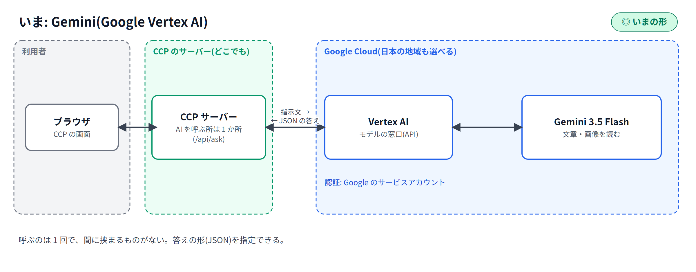
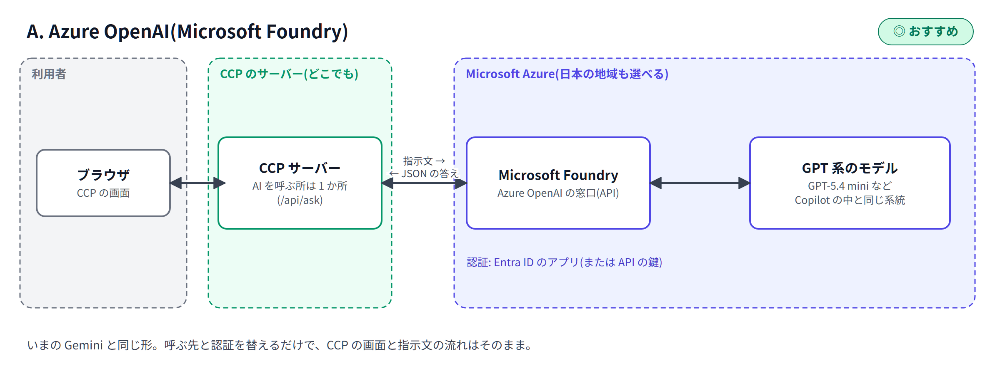
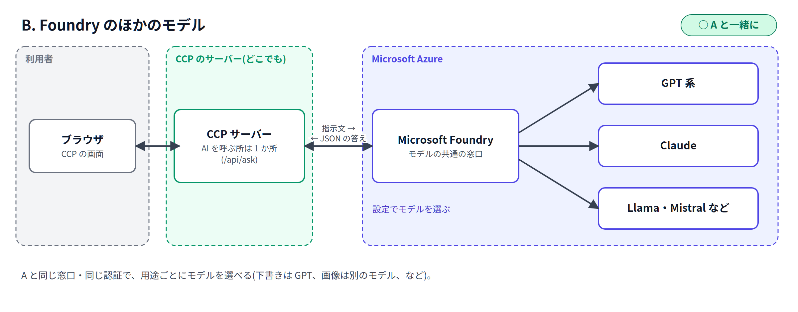
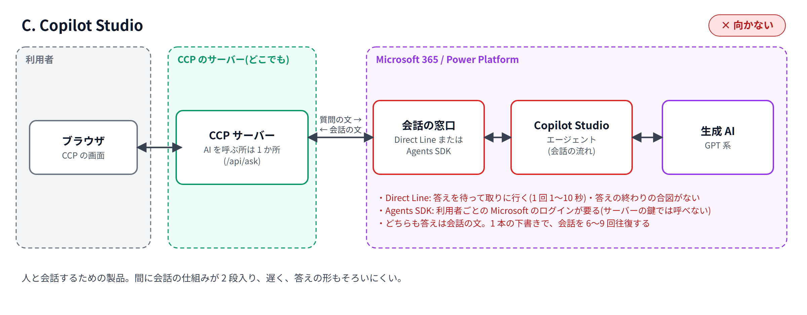
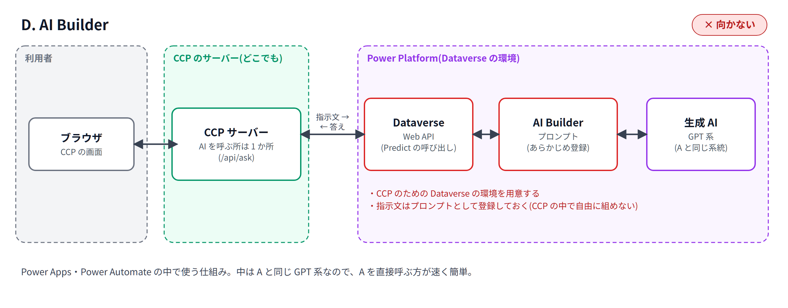
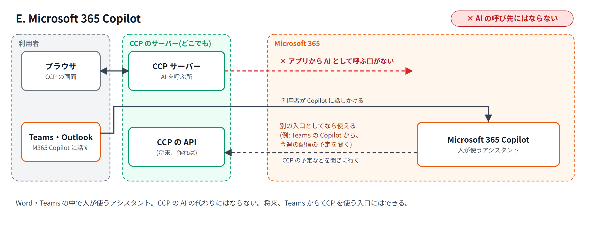

# CCP で使う AI の比較: Gemini と Microsoft(Copilot 系)

2026-10-27 作成。料金は 2026 年 10 月時点の公開情報をもとにした**目安**です。実際の契約・地域・為替で変わります。

**前提**: CCP のサーバーを、どこへでもつながる場所に置いて使うものとします(ネットワークの制約はないものとして比べます)。

## 結論

- **Microsoft で進めるなら、「Microsoft Foundry の Azure OpenAI」をおすすめします。** Microsoft の Copilot 製品の中で動いている GPT 系のモデルを、CCP から直接呼ぶ形です。いまの Gemini と同じ使い方ができます。
- **Copilot Studio・AI Builder・Microsoft 365 Copilot は、CCP の AI の呼び出し先には向きません。** どれも「人が Teams や Power Apps の中で使う」ための製品で、CCP のようなアプリから何度も呼ぶ使い方に合いません。
- **Gemini と Azure OpenAI は、使い方・料金の形がほぼ同じです。** 違いは、モデルの得意・不得意と、どちらの会社のクラウドの契約・決まりで使うかです。どちらのモデルが CCP の下書きに合うかは、同じ指示文で試して比べるのが確実です。

## 1. CCP の AI の使い方(前提)

| 用途 | 内容 | 呼ぶ回数 |
|---|---|---|
| 配信の下書き | テーマ・件名・見出し・コピー・商品の選定・制作指示などを作る | 配信 1 本の下書きで 6〜9 回 |
| 部品ごとの AI | 見出しやコピーの言い換え、商品の入れ替えの候補など | 操作のたびに 1 回 |
| 画像を読む | メイン画像・部品の画像・商品の画像を見て、説明や代替テキストを書く | 画像を足すたびに 1 回 |

- CCP は、AI に指示文を渡し、**決まった形のデータ(JSON)で答えを受け取って**、画面に並べます。そのため、**速さ・JSON の正確さ・画像を読めること**が大事です。
- いまは Google の **Gemini 3.5 Flash**(Vertex AI)を使っています。
- CCP の中では、AI を呼ぶ所を 1 か所にまとめてあります。そのため、**呼び出し先を替えるのは、サーバーの一部の作り直しで済みます**。

## 2. 候補

| | 候補 | どんなものか |
|---|---|---|
| いま | **Gemini**(Google Vertex AI) | Google の AI のモデルを、API で呼ぶ |
| A | **Azure OpenAI**(Microsoft Foundry) | Microsoft の Azure で、GPT 系のモデルを API で呼ぶ。Copilot 製品の中で動いているのも GPT 系 |
| B | **Foundry のほかのモデル** | A と同じ Foundry の中で、Claude・Llama・Mistral など、ほかの会社のモデルも呼べる |
| C | **Copilot Studio** | ノーコードで「エージェント」(会話する AI)を作る製品。Teams やサイトに置いて、人と会話する |
| D | **AI Builder** | Power Apps・Power Automate の中で AI を使う仕組み(プロンプト・書類の読み取りなど) |
| E | **Microsoft 365 Copilot** | Word・Excel・Outlook・Teams の中で、人が使う AI のアシスタント |

### 接続イメージ

どの図も、左から「利用者のブラウザ → CCP のサーバー → AI」の順です。間に挟まるものが少ないほど、速く、答えの形も安定します。

## 3. 比較

| 観点 | Gemini(いま) | A. Azure OpenAI | B. Foundry のほかのモデル | C. Copilot Studio | D. AI Builder | E. M365 Copilot |
|---|---|---|---|---|---|---|
| CCP から呼べるか | ◎ いま使っている | ◎ API で呼べる | ◎ A と同じ形で呼べる | △ 会話の窓口を通して呼ぶ形になる | △ Power Platform の環境(Dataverse)を通して呼ぶ | × アプリから呼ぶ先ではない |
| 速さ(1 本で 6〜9 回呼ぶ) | ◎ | ◎ | ○〜◎(モデルによる) | × 間に会話の仕組みが入り、遅い | △ 間に Dataverse が入る | − |
| 決まった形(JSON)での答え | ◎ 形を指定できる | ◎ 形を指定できる | ○〜◎ | △ 会話の文が前提 | ○ | − |
| 画像を読む | ◎ | ◎ | ○〜◎ | △ | ○ | − |
| モデル・設定の自由さ | ◎ | ◎ | ◎ | △ 製品が決める | △ 製品が決める | × |
| データの扱い | 学習に使われない。Google Cloud の中(日本の地域も選べる) | 学習に使われない。Azure の中(日本の地域も選べる) | A と同じ | Microsoft 365・Power Platform の中 | Power Platform の中 | Microsoft 365 の中 |
| 用意するもの | Google Cloud のプロジェクトと、サービスアカウント | Azure の契約と Foundry のリソース、Entra ID のアプリ(または API の鍵) | A と同じ | Copilot Studio の契約と、エージェントの作成 | Power Platform の環境(Dataverse)と、プロンプトの作成 | Microsoft 365 Copilot の契約 |
| CCP の作り直し | なし | 小〜中(呼ぶ所の作り直しと、指示文の合わせ直し) | A と同じ | 大(呼び方がまるで違う) | 大(Power Platform の環境を作り、つなぐ) | − |
| 料金の形 | 使った分(文字の量) | 使った分(文字の量) | 使った分(文字の量) | Copilot クレジット(答え 1 回ごと) | Copilot クレジット(AI Builder のクレジットは 2026-11 に終わり、移る) | 1 人あたりの月額 |
| CCP に合うか | ◎ | **◎ おすすめ** | ○ A と一緒に | × | × | × |

### C・D・E が向かない理由(補足)

- **C. Copilot Studio**: 人と会話するエージェントを作る製品です。CCP は、1 本の下書きで 6〜9 回 AI を呼び、決まった形のデータを受け取ります。会話の仕組みを間に挟むと遅くなり、答えの形もそろいにくくなります。CCP の以前の版で試しましたが、この理由でやめました。
  - アプリのサーバーから呼ぶ方法は 2 つあり、どちらにも制約があります。
    - **Direct Line**: 鍵(秘密の文字列)で呼べます。ただし、答えは「待って取りに行く」仕組みで、1 回ごとに 1〜10 秒ほどの待ちが入ります。答えの終わりを知らせる合図がなく、Copilot Studio のエージェントでは答えを少しずつ受け取る(ストリーミング)こともできません。
    - **Microsoft 365 Agents SDK**: 速く、ストリーミングもできます。ただし、**呼ぶたびに、使っている人の Microsoft(Entra ID)のログインが要ります**。サーバーの鍵(サービスプリンシパル)だけでは呼べないので、CCP の利用者全員に Microsoft のログインを付ける必要があります。
    - どちらも、答えは会話の文です。
- **D. AI Builder**: Power Apps・Power Automate の中で使う仕組みです。CCP から呼ぶには、Power Platform の環境(Dataverse)を用意してつなぐ必要があります。中で動いているのは A と同じ GPT 系なので、A を直接呼ぶ方が速く、簡単です。
- **E. Microsoft 365 Copilot**: 人が Word や Teams の中で使うアシスタントです。アプリが AI を呼ぶ先としては使えません。ただし、将来「Teams の Copilot から CCP の配信の予定を聞く」のような**別の入口**を作ることはできます。

## 4. モデルの比べ方(Gemini と A・B)

CCP に合うかどうかは、モデルの得意・不得意で決まります。おすすめの比べ方:

| 比べること | 見方 |
|---|---|
| 下書きの質 | 同じ配信の条件で下書きを作り、配信を作る担当の方が、テーマ・コピー・商品の選び方を見比べる |
| 決まりを守るか | 文字数・使ってはいけない言葉・ページに書いていないことを書かない、などを守れているか |
| JSON の正確さ | 答えの形が崩れて、やり直しになった回数 |
| 速さ | 1 本の下書きにかかった時間 |
| 画像を読む力 | 商品・メイン画像の説明が、写っているものと合っているか |
| 料金 | 1 本の下書きにかかった料金 |

比べる候補の例(どれも、同じくらいの価格帯の「速い・安い」モデル):

| モデル | 置き場 | 料金(100 万トークンあたり。渡す / 返る) |
|---|---|---|
| Gemini 3.5 Flash(いま) | Google Vertex AI | 1.50 ドル / 9.00 ドル |
| GPT-5.4 mini | A. Azure OpenAI | 0.75 ドル / 4.50 ドル |
| GPT-5 mini(一つ前の世代) | A. Azure OpenAI | 0.25 ドル / 2.00 ドル |
| Claude などのほかのモデル | B. Foundry | Foundry の料金表で確認 |

CCP は呼び出し先を設定で切り替えられるようにできるので、**同じ画面・同じ指示文のまま、モデルだけを替えて比べられます**。

## 5. 料金の目安

### 前提(仮の数字)
- 1 か月に AI を **3,000 回**呼ぶ(配信の下書き 200 本 × 8 回 = 1,600 回 + 部品ごとの AI・画像を読む 1,400 回)。
- 1 回あたり、渡す文字が **6,000 トークン**(商品の一覧などを含む)、返る文字が **1,500 トークン**(考える分を含む)。
- 1 か月の合計: 渡す **1,800 万トークン**、返る **450 万トークン**。
- 1 ドル = 150 円で計算。

### 目安

| 候補 | 料金 | 1 か月の目安 |
|---|---|---|
| Gemini 3.5 Flash(いま) | 1.50 ドル / 9.00 ドル(100 万トークンあたり) | 約 68 ドル(約 1 万円) |
| A. Azure OpenAI GPT-5.4 mini | 0.75 ドル / 4.50 ドル(同) | 約 34 ドル(約 5 千円) |
| A. Azure OpenAI GPT-5 mini | 0.25 ドル / 2.00 ドル(同) | 約 14 ドル(約 2 千円) |
| C. Copilot Studio | 1 クレジット 0.01 ドル。AI の答え 1 回で 2 クレジット、操作(アクション)を使うと 5 クレジット〜 | 約 60〜150 ドル(約 1〜2 万円)。答えの作り方で大きく変わる |
| D. AI Builder | Copilot クレジットで払う(プロンプトの長さで変わる) | 見積もりにくい。別に Power Platform の環境の費用 |
| E. M365 Copilot | 1 人 月 30 ドル(別に Microsoft 365 の契約が要る) | 人数しだい。CCP の AI の代わりにはならない |

- **AI の料金そのものは、どれを選んでも月 1〜2 万円以下**の見込みです。料金よりも、**下書きの質・速さ・作り直しの手間**で選ぶのがよいと考えます。
- 実際の料金は、Microsoft・Google の料金表と、使う組織の契約(割引・前払いなど)で確かめてください。

## 6. Azure OpenAI(A)で進めるときの段取り

| 順 | やること | 担当 | 目安 |
|---|---|---|---|
| 1 | Azure に Foundry のリソースを作り、モデル(GPT 系)を使えるようにする。地域は日本(東日本など)を選べる | 御社の Azure の管理者 | 1 日 |
| 2 | CCP から Azure を呼ぶための認証(Entra ID のアプリ、または API の鍵)を用意する | 御社の Azure の管理者 | 1 日 |
| 3 | CCP の AI の呼び出し先を、設定で Gemini / Azure OpenAI に切り替えられるようにする | 開発 | 数日 |
| 4 | 4 章の比べ方で、Gemini と GPT 系を比べる。指示文を GPT 系に合わせて直す | 開発 + 御社の担当者 | 1〜2 週 |
| 5 | 比べた結果で、使うモデルを決める | 御社 | − |

- 切り替えは設定で行えるようにするので、**試している間も Gemini に戻せます**。
- 開発者向けの画面(BigQuery の SQL を AI が書く機能)は、Google Cloud と結びついているため、Gemini のまま残すのが簡単です。

## 7. 決めていただきたいこと

1. **A(Azure OpenAI)で比べてみてよいか**。
2. 使う Azure の契約・地域(日本の地域を使うか)。
3. 比べる期間と、比べる人(配信を作る担当の方に、下書きの質を見ていただきたい)。

## 出典(料金)

- Google Cloud「Vertex AI の料金」 https://cloud.google.com/vertex-ai/generative-ai/pricing
- Azure OpenAI の料金の解説(GPT-5 mini) https://inference.net/content/azure-openai-pricing-explained/
- Azure AI Foundry の GPT-5.4 mini の料金 https://futureagi.com/llm-cost-calculator/azure-ai-foundry/gpt-5-4-mini
- Copilot Studio の料金(Copilot クレジット) https://www.cloudzero.com/blog/copilot-studio-pricing/
- AI Builder のクレジットの終了(2026-11-01) https://nordflux.de/en/insights/ai-builder-credits-are-ending-what-power-automate-users-need-to-clarify-by-november-2026
- Microsoft 365 Copilot の料金 https://eesel.ai/blog/copilot-pricing
- Copilot Studio のエージェントをアプリから呼ぶ方法の比べ方(Microsoft の Copilot Studio のチームのブログ) https://microsoft.github.io/mcscatblog/posts/copilot-studio-api-decision-guide/
- Microsoft 365 Agents SDK でアプリとつなぐ(Microsoft Learn) https://learn.microsoft.com/en-us/microsoft-copilot-studio/publication-integrate-web-or-native-app-m365-agents-sdk

※ Azure・Copilot の料金は、Microsoft の公式の料金表ではなく、料金をまとめたサイトの情報です。決める前に、Microsoft の料金表で確かめてください。
