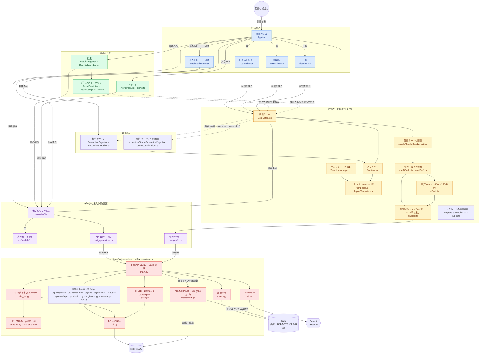

# ソースの地図: ファイルの構造と役割

CCP のソースファイルが、どこに・何のためにあるかの一覧。はじめてコードを読む人と、「この変更はどこを触ればよいか」を探す人向け。

- 最終更新: 2026-10-30(`main` の時点のファイル。行数は目安)
- 設計の約束事・AI の仕組みの詳しい話は [ARCHITECTURE.md](ARCHITECTURE.md)<!-- hosted:begin -->、サーバー・DB・AI は [GCP.md](GCP.md)、いまどこにいるかは [HANDOVER.md](HANDOVER.md)<!-- hosted:end -->
- ファイルを足したり、役割を変えたりしたら、この表も直す

---

## 1. 全体の形

画面のコード(`src/`)は 1 つで、**データと AI の出入り口だけを差し替えて、2 種類のアプリを作る**。

```
                    画面のコード(src/*.tsx, src/*.ts) ── どちらのビルドでも共通
                                   │
            src/data/<表>.ts の …Service を呼ぶ(型は src/models)
                                   │
              ┌────────────────────┴────────────────────┐
              ▼                                         ▼
 本番(サーバー・Workbench)                      撮影・デモ用
 vite.config.ts                                  vite.mock.config.ts
 src/gcp/services.ts → server/ の API            src/mock/db.ts に差し替え(メモリ上のデータ)
 AI は /api/ask(Gemini)                         AI は src/mock/agent.ts
              │
              ▼
     server/(FastAPI)
     PostgreSQL・画像・Gemini
```

- **Power Apps 版は 2026-10-16 に廃止し、ソースも削除した。** 同じ日に、名前(`cr854_…`)と選択肢の数も、読みやすい名前・文字の値に変えた(GCP.md の「データ定義」)。 <!-- hosted -->
- 撮影・デモ用の差し替えは、`vite.mock.config.ts` のプラグインが、サービスの読み込みを置き換えて行う。そのため、画面のコードはビルドの違いを知らない。

### 構成図(ファイルのつながり)

主なファイルと、呼び出しのつながり。GitHub では、図として表示される。 同じ図の draw.io 版は [source-map.drawio](source-map.drawio)(Confluence の draw.io などで読み込める。中の言葉は、動かす環境に依存しない書き方にしてある)。下の図を変えたら、draw.io 版も合わせる。



- 実線は呼び出し、点線は「上に重ねて開く」つながり。
- 撮影・デモ用のビルドでは、「表ごとのサービス」と「AI の呼び出し」が、`src/mock/`(メモリ上のデータ・サンプルの返答)に差し替わる。サーバー側は使わない。

## 2. 一番上の階層

| パス | 役割 |
|---|---|
| `src/` | 画面のコード(React 19 + TypeScript + Fluent UI v9) |
| `server/` | サーバー(Python / FastAPI)。画面・データ API・AI・画像を配る |
| `scripts/` | 反映・検証・撮影・Workbench の運用などの補助スクリプト |
| `docs/` | 文書、ワイヤーフレーム、スクリーンショット、サンプルデータ(CSV) |
| `.github/workflows/ci.yml` | GitHub の CI(スキーマの照合・型チェック・lint・ビルド・サーバーのテスト) | <!-- hosted -->
| `index.html` | 画面の入口の HTML |
| `vite.config.ts` / `vite.mock.config.ts` | ビルドの設定(本番 / 撮影用。1 章) |
| `package.json` | npm のスクリプト(`dev`・`build`・`verify`<!-- hosted:begin -->・`deploy:gcp`<!-- hosted:end -->・`dev:gcp` と `build:gcp`(`dev`・`build` と同じ。Workbench の手順のため)<!-- hosted:begin -->・`screenshots`<!-- hosted:end -->・`seed:export`・`release:workbench`) |
| `Dockerfile` / `.dockerignore` / `.gcloudignore` / `cloudbuild.yaml` | Cloud Run のコンテナと、そのビルド | <!-- hosted -->
| `tsconfig*.json` / `eslint.config.js` | 型チェック・lint の設定 |
| `CLAUDE.md` / `README.md` | AI アシスタント向けの約束事 / 全体の紹介 |

## 3. 画面(`src/`)

### 3.1 入口と土台

| ファイル | 行数 | 役割 |
|---|---|---|
| `main.tsx` | 28 | 起動。フォント・CSS を読み、`Root` を描く |
| `Root.tsx` | 16 | Fluent UI のテーマで `App` を包む |
| `App.tsx` | 1,637 | **画面の入口**。ヘッダー(システム全体: 国・アラート・依頼・新規作成・あなた・⚙)、作業の段(計画 / 制作 / 結果 の切り替えと絞り込み)、面の帯、月 / 週 / 一覧の切り替え、フロート(配信カード・制作のページ・結果・アラート)を開く、画面の状態と URL の行き来 |
| `deepLink.ts` / `CopyLinkButton.tsx` | 88 / 39 | 画面の状態(面・見せ方・期間・国・開いているフロート)を URL のクエリと行き来させる / 「リンクをコピー」 |
| `faces.ts` / `FaceBadge.tsx` / `StageNav.tsx` | 28 / 36 / 174 | 面(計画・制作・結果)の色と名前 / フロートの面の札 / フロートの段階の帯(PLAN → PRODUCTION → RESULTS) |
| `floatLayout.ts` | 74 | フロートの大きさとペインの幅を変えて覚える、共通の部品 |
| `MePicker.tsx` / `InboxButton.tsx` | 256 / 61 | 右上の「あなた」(選んでログイン・切り替え・ログアウト。最初の「だれでログインしますか?」) / 右上の「依頼」(自分宛ての承認の依頼) |
| `theme.ts` | 70 | Fluent UI のテーマ(色・書体) |
| `fonts.ts` | 23 | 同梱のフォント(外部の CDN に頼らない) |
| `index.css` | — | 全体の CSS と、印刷(週の資料・レポート)のときの見せ方 |
| `i18n.ts` | 148 | 日本語 / English の切り替え(`t` / `tr` / `useT` / `optionLabel`) |
| `appRoot.ts` | 22 | アプリの置き場所。API・画像のパスの基準(Workbench の `/proxy/8082/` の下でも動くように) |
| `settings.ts` | 48 | アプリ全体の設定(自動下書きのオン・オフなど。ブラウザごと) |
| `AppToolbar.tsx` / `appToolbarParts.ts` | 423 / 41 | 上に留めるヘッダーと面の帯(狭い画面ではアプリ名を隠し、絞り込みの札は収まらないときだけ 2 段目)/ App と共有する、絞り込みと面の切り替えのボタンの形 |
| `useAppData.ts` / `useUrlSync.ts` | 306 / 30 | 画面全体が使う表の読み込みと読み直し(変わった表だけ選べる)・上の帯の知らせ / 画面の状態を URL に持たせ、「戻る」「進む」で戻す(どちらも App から分けた) |
| `lazyViews.tsx` / `simpleProductionChunk.ts` / `chunkReload.ts` | 47 / 10 / 43 | 開いたときに読み込む画面(最初の読み込みを軽くする。`SimpleProductionView` は読み終わっていれば lazy を通さずに描く)/ 制作のシンプルな画面のプログラムを、配信カードを開いたときに裏で先に読む(PLAN → PRODUCTION の最初の切り替えで、後ろのカレンダーが見えないように)/ 分けたファイルが読めなかったとき(古い版のまま開いていたタブ)に、一度だけ読み直す |
| `ErrorBoundary.tsx` | 71 | 画面の一部が落ちたときの受け皿(画面・配信を移ると描き直す。重ねて開く画面は閉じられる) |
| `SettingsDialog.tsx` / `settingsActions.tsx` | 272 / 530 | 設定の画面(ST10。⚙ はこの入口だけ。左に 自分 / 国 / 全社 / 開発・管理、右に中身)/ そこに並べる操作(国・全社の設定の欄、取り込み・書き出し・見本の作成) |
| `userPrefs.ts` / `prefKeys.ts` | 82 / 71 | 人の設定(ペインの幅・フロートの大きさ・言語など)を、ログインした人ごとにサーバーへ写す(ST6。`/api/prefs`)/ ブラウザに覚える設定の鍵の一覧 |
| `store.ts` / `layers.ts` | 48 / 17 | 画面全体で共有する値の小さな入れ物(React の外からも読み書き)/ 画面全体に重ねるものの重なりの順(z-index) |
| `confirm.ts` / `ConfirmHost.tsx` | 55 / 41 | 確かめの窓(`window.confirm` の代わり。関数で開き、答えを Promise で返す)/ それを描く所(App に 1 つ) |
| `dates.ts` / `clipboard.ts` | 19 / 17 | 日付の小道具(ブラウザの時刻の YYYY-MM-DD。UTC でずれないように)/ クリップボードに書く(使えない環境でも写せるように) |
| `useStableCallback.ts` / `useOpenedOnce.ts` | 14 / 12 | いつも同じ関数を返す(memo の部品に渡す)/ 一度でも開いたか(閉じた窓を、開くまで描かない) |
| `exportPack.ts` | 50 | ⚙ の「データと画像を書き出す」(受け取りながら大きさを知らせ、受け取り終えてから保存) |

### 3.2 計画の面(カレンダー・週・一覧)

| ファイル | 行数 | 役割 |
|---|---|---|
| `Calendar.tsx` | 384 | 月のカレンダー(配信・締め切りの近い配信・アラートの印) |
| `WeekView.tsx` | 468 | 週の表示(縮小プレビューつき。商品のバランス / 進み具合 / 時刻 の 3 つの見方。時刻は `WeekTimeGrid`) |
| `WeekTimeGrid.tsx` | 338 | 週の表示の「時刻」の見方(X46。横 = 曜日・縦 = 時刻の格子に配信を置く。同じ時刻の印、つかんで別の日・時刻へ動かす(15 分きざみ)) |
| `WeekReviewBar.tsx` | 255 | 週の状態の帯(レビューに出す・確定・承認、確定後の変更、承認の履歴、PDF) |
| `WeekChecklist.tsx` | 180 | 週の確認の一覧(項目ごとの件数と中身) |
| `reviewChecks.ts` | 199 | 週の確認の判定(上限超えの商品・主力の漏れ・連続 など) |
| `weekLabels.ts` | 63 | 週のレビューの項目名・説明・履歴の文言(画面と PDF で共通) |
| `weekLock.ts` | 96 | 確定した週の、変更の制限 |
| `LockMark.tsx` | 19 | 週が確定した配信の鍵マーク(配信は「承認済み」に添えて見分ける。U6) |
| `WeekReport.tsx` / `printWeek.ts` | 206 / 48 | 週の資料(A4 の PDF)と、その印刷 |
| `ListView.tsx` / `listRows.ts` | 107 / 112 | 表の形の一覧と、その列の定義(CSV の書き出しも同じ定義) |
| `MiniCalendar.tsx` | 183 | ツールバーのミニカレンダー(月・週・日へ移る) |
| `bulkDraft.ts` | — | まとめて AI で中身を作る(W14)の、中身を作る・下書きを保存する・週の日の一覧(作業画面 `useBulkWorkspace.ts` が使う。2026-10-24 に、比べるために残していた週の枠の作り(`useWeekFrames`・`FrameBar`・`FrameCard`・`CheckDrawer`)を消した) |
| `useBulkWorkspace.ts` / `BulkWorkspace.tsx` | 708 / 926 | まとめて作る作業画面(W14 の 4 回目の見直し)の状態と操作(App が持つ。① は保存しない) / 画面(① 対象と方向 → ② 中身を AI で作る → ③ 確かめる。① のあと、中身を作らずに保存もできる) |
| `DeliveryPeek.tsx` / `CardPreview.tsx` | 34 / 79 | 配信にマウスを重ねたときのプレビュー / 保存済みの配信カードのプレビュー |
| `status.ts` / `progress.ts` | 53 / 163 | 配信のステータスの色・チャネル / 工程(進み具合) |
| `ChannelBadge.tsx` | 54 | メール / アプリの札(配信カード・月・週・一覧・結果で共通) |
| `StatusFlow.tsx` / `MonthSummaryBar.tsx` | 46 / 65 | 件数の流れ(未起案 › 承認待ち › 承認済み)/ 月の要約の帯 |
| `WeekRetro.tsx` / `WeekHistory.tsx` | 222 / 60 | 週・月の振り返りのメモ(結果の面で書き、AI で下書きもでき、翌週・翌月の計画の面に出す。月の振り返りの表は `data/months.ts`)/ 週の承認の履歴 |
| `DataTable.tsx` | 154 | 一覧の表(並べ替え・サムネイル。計画と結果で共通) |
| `WeekLensTabs.tsx` / `WeekCompare.tsx` | 81 / 226 | 週の見方のタブ(商品 / 進み具合 / 時刻 / 前週と比べる。「週」のボタンから下に生える形)/ 見方「前週と比べる」(C1。当週と比べる週を上下にそろえ、両方に出た商品・メイン画像・テーマの種類を出す) |
| `BulkPreviewFloat.tsx` | 120 | まとめて作る作業画面で、1 本ずつプレビューを見るフロート(保存前の案もそのまま描く) |
| `useCardNoteStats.ts` | 72 | やり取り(`card_notes`)を、配信カードごとに数える |

### 3.2.1 キャンペーン(X79。配信カードの親)

キャンペーン(親) › 配信カード(子) › AB の案(孫)。キャンペーンは名前・国・テーマ・目的だけを持ち、配信日・状態は子のカードから出す。

| ファイル | 行数 | 役割 |
|---|---|---|
| `campaigns.ts` | 99 | キャンペーンの決まり(入れる条件は同じ国・同じ配信日)。表は `data/campaigns.ts` |
| `useCampaigns.ts` / `useCampaignOf.ts` | 22 / 27 | キャンペーンを読む(月のカレンダー・時間帯別)/ 開いたカードの親を読む |
| `CampaignBand.tsx` | 212 | 配信カードのいちばん上の帯(キャンペーン / そのキャンペーンのカードのタブ / AB の案 の 3 段) |
| `CampaignApprove.tsx` / `campaignOps.ts` | 181 / 210 | 子のカードをまとめて承認を依頼する・承認する(送る前の確認で止まるカードだけ止める)/ キャンペーンの操作(まとめての承認・作る・足す) |
| `CampaignDialogs.tsx` | 249 | キャンペーンを作る窓と、カードを足す窓 |
| `campaignLook.ts` | 32 | 時間帯別の札の名前と、同じキャンペーンのカードをそろえる線の色 |
| `campaignMigrate.ts` | 219 | いまの配信カードを、キャンペーンにまとめて作り直す(開発用の画面 `dev/CampaignTab.tsx` から回す) |

### 3.3 配信カード(全画面のフロート)

配信カードの画面は 1 つ(`simple/`。3.3.1): **左のバー**(アラート・学び・やり取り・承認・素材・渡すもの・変更)/ **プレビュー** / **選んだ部品のペイン** / 商品の一覧。この節は、その土台(読み込み・状態・保存)と、ほかの画面とも共有する部品。

| ファイル | 行数 | 役割 |
|---|---|---|
| `CardDetail.tsx` | 1,206 | **配信カードの本体**。読み込み・保存の入口、AI の下書きの起動、承認・差し戻し。描き方は `simple/SimpleCardLayout.tsx` の 1 つだけ(2026-10-28 に、詳しい配信カードと、その切り替えを消した) |
| `useCardEditor.ts` | 755 | 配信カードの中身(入力欄・商品・候補・テンプレート・見出し・メイン画像・リンク・案)と、変えたかの判定・保存。**状態と保存は、ここ 1 か所だけ** |
| `cardDetailStyles.ts` | 44 | 配信カードの枠・知らせ・AI の下書きの重ね(CardDetail の見た目) |
| `cardForm.ts` / `saveFlow.ts` | 78 / 105 | 入力欄の値(画面の state)と、行からの作り方 / 保存の流れ(決める `planSave` と、決まった順に行う `runSave`。`scripts/check-save.mjs` が確かめる) |
| `useAbVariants.ts` / `useCardAlerts.ts` | 511 / 106 | AB テスト・案から選ぶの、案の中身と出し入れ / アラートへの対応と商品の差し替え(理由は保存で配信のメモに) |
| `DeliveryInfoFields.tsx` | 169 | 配信の情報の入力欄(配信名・日時・状態・対象・担当。シンプルな配信カードの配信の情報で使う) |
| `CardHistory.tsx` | 192 | 変更の履歴(X1。項目の変更・ステータスの変化・差し替えの理由を、新しい順に 1 本に) |
| `EmptyDraftCta.tsx` | 61 | 空の配信カードの、プレビューの真ん中の「AI で下書きする」(押したときだけ下書きする) |
| `slots.ts` | 146 | 選定済みの商品の並びと、セクションの枠の対応(空いた枠の行。保存済みの位置をずらさない。`scripts/check-slots.mjs`) |
| `textLimits.ts` | 4 | メールの件名・プリヘッダーの文字数の目安(2 つの画面で共通) |
| `CardMenu.tsx` | 263 | 「…」メニュー(複製・取りやめ・削除) |
| `duplicate.ts` | 108 | 配信カードの複製(写す列・写さない列、載せた商品の写し、初めの配信日時) |
| `cancel.ts` | 61 | 配信の取りやめ(消さずに残す) |
| `CardAlertsBar.tsx` | 150 | 配信カードの上の、アラートの帯(たたむ・種類の札・「対応する」) |
| `AbResult.tsx` / `abResults.ts` | 174 / 147 | 詳しい結果の「AB テストの結果」(案ごとの数字・勝ち案・偶然の範囲かの目安)/ その計算(2 つの割合の z 検定・学びの文) |
| `abSeed.ts` | 228 | ⚙ の「AB テスト・案から選ぶの例を作る」(例の配信 5 本を足す。`ab_test` の `seed` で見分ける) |
| `ImpactView.tsx` / `impact.ts` / `useDeliveryImpact.ts` | 906 / 376 / 74 | 結果の面の見せ方「効果」(増えた売上・リフト率、学びの記録と評価)/ その計算と見本 / 詳しい結果に出す、配信 1 本の効果 |
| `SwipePager.tsx` | 158 | 週・月の表示を、地の部分をつかんで横に引く(トラックパッドの横スワイプ)と、前後の週・月へ |
| `AbBadge.tsx` / `AbCompare.tsx` / `abAi.ts` | 74 / 131 / 149 | AB テストの印(月・週・一覧・時刻の格子)/ 案のプレビューを並べて比べる / 「B 案を AI で作る」(画像・商品と、比べる要素なら文言・件名も) |
| `abTest.ts` | 245 | AB テスト(X55)の型・既定・配分・制作に渡す文(設定の画面は `simple/AbSettings.tsx`) |
| `ProductActionFloat.tsx` / `ItemAlertOverlay.tsx` | 306 / 131 | 商品の対応のフロート(アラートへの対応と、商品の詳しい情報・差し替えを 1 つに。つかんで動かせる。画像はいまのものを見せるだけで、替えるのは部品のペインの「画像を替える」)/ プレビューの商品の枠に重ねるアラートの札 |
| `ProductFloat.tsx` / `ProductMarks.tsx` | 35 / 64 | 商品の行の開き口(中の「選定済み」・右の商品情報の行を押すと、商品の対応のフロートを開く。行の中のボタン・入力欄は除く)/ 商品の行の札(アラートの種類の札・「残少」。商品情報と中の選定済みの行で共通) |
| `target.ts` | 57 | 配信の対象(性別・年代・アプリの送る相手)の値と表示、AI に渡す文、商品の性別での絞り込み |
| `ApprovalBar.tsx` | 419 | 承認の依頼・承認・差し戻し |
| `features.ts` / `featureFlags.ts` / `FeaturesManager.tsx` / `FeatureBadge.tsx` | 236 / 152 / 446 / 34 | 機能の公開・非公開(X87。3.1 の作り替え): 機能の一覧(大・中・小・コードの版・前提)/ 判定 `isOn`(版が always ならいつも公開、dev は開発者だけ。機能ごとの上書き 止める / 先に出す / 版に従う → 付け替えた版かコードの版の公開。親を止めると子も非公開)・開発者・「一般の人として見る」/ ⚙ の「使える機能」(版ごとの公開の切り替え、行ごとの版の付け替えと上書き(理由つき)、隠れる機能の知らせ、変えたことの記録。あいまいな検索つき)/ 開発者に出す「非公開」の印。表は `data/featureSettings.ts`(機能ごとの版・上書き・理由)・`data/featureVersions.ts`(版ごとの公開)・`data/featureLogs.ts`(だれ・いつ・何を・なぜの記録)。型は `models/` の同じ名前のファイル |
| `LearningsBar.tsx` | 392 | 「これまでの学び」(過去の結果から) |
| `Splitter.tsx` / `ResizeHandles.tsx` | 105 / 75 | ペインの幅の変更 / フロートの大きさの変更 |

**配信カードの欄・部品**(選んだ部品のペイン・渡すもの・制作のページなどから使う)

| ファイル | 行数 | 役割 |
|---|---|---|
| `contentPaneStyles.ts` | 154 | テンプレートの使われ方の行(`TemplateUseLine`)の見た目 |
| `PartContentFields.tsx` / `partContent.ts` | 114 / 138 | テンプレートの部品の、配信ごとの中身を直す欄(テンプレートで許した所だけ。2 つの画面で共通)/ その持ち方(列 `part_content`。`scripts/check-parts.mjs`) |
| `TemplateUseLine.tsx` | 52 | テンプレートを選ぶ所の、使われ方の行と、版・無効・国で使わないの知らせ(2 つの画面で共通) |
| `ProductRow.tsx` / `Candidates.tsx` | 177 / 161 | 選定した商品の行 / 候補の一覧(大量でも重くならないように) |
| `HeroCandidates.tsx` | 110 | メイン画像の候補(すべての画像から探して設定) |
| `ChatPanel.tsx` | 247 | AI チャット |
| `NotesEditor.tsx` / `MarkdownLite.tsx` | 139 / 52 | 制作指示の入力(Markdown。箇条書き・見出しつき。配信カードでは渡すものの欄)/ その表示 |
| `links.ts` | 348 | 配信ごとのリンク先(JSON で保存)と、計測用のパラメーター(UTM)の決まり(utm_campaign・utm_content。X67) |
| `pushLink.ts` / `AppLinksEditor.tsx` | 46 / 254 | 通知を押したときに開く画面 / アプリのリンク先の入力 |
| `TasksPanel.tsx` | 196 | タスク(プロセスのペインの「タスク」タブ) |
| `assetSeed.ts` | 230 | ⚙ の「素材の見本を作る / 消す」(画面の中で描いたイラスト・PDF と公開の URL を、制作の依頼のある配信に。名前の先頭が「見本:」) |
| `uiScale.ts` | 40 | 画面全体の表示の大きさ(X60。zoom と --ui-zoom、viewWidth / viewHeight、getUiScale) |
| `weeklyLimit.ts` | 75 | 週の上限(C3。マーケティングの決まりの「上限 週 N 回」→ なければアラートの条件の値) |
| `HeroLibrary.tsx` | 312 | ⚙ の「画像のライブラリ」(メイン画像の一覧・絞り込み・上げる・直す・消す・期限を切る・空の項目を AI で埋める。タブで部品の画像。X59) |
| `PartLibrary.tsx` / `PartUploadDialog.tsx` / `PartPicker.tsx` | 195 / 273 / 84 | 部品の画像(ボタン・バナー・ロゴ・アイコン。X59 ③)のライブラリ / 上げる・直す(AI の下書き・代替テキスト)/ 制作のページの左の欄(URL・`` のタグをコピー)。窓口は `data/partUpload.ts`、表は `data/partImages.ts`、サーバーは `server/ccp/parts.py` |
| `imageConvert.ts` | 62 | AVIF を JPEG・PNG に変える、画面の画像を AI に見せる JPEG にする(X59) |
| `HeroUploadDialog.tsx` / `heroRights.ts` | 371 / 22 | 持っている画像をメイン画像のライブラリに上げる・直す(AI の下書き・焦点と拡大・出どころ・期限。X59)/ 使える期限と、焦点・拡大の切り出し。窓口は `data/heroUpload.ts` |
| `FinishedFloat.tsx` | 142 | 仕上がりを見る(X58。制作した HTML・制作からのひとこととリンク・直してほしいこと・制作指示・素材を 1 つのフロートで) |
| `CreativeAssets.tsx` / `creativeConst.ts` | 647 / 7 | 素材(Creative Assets。X58): 配信ごとの参考のファイル・URL の一覧・追加・素材のフロート(大きく見る・素材へのやり取り)/ 添付できる種類と大きさ。ファイルの窓口は `data/creativeFiles.ts`、表は `data/cardAssets.ts` |
| `creativePreview.ts` | 23 | URL の素材の見本カード(ページの題名・説明・サイト名・代表の画像)を取り、素材の行に書く。サーバーは `server/ccp/linkpreview.py` |
| `CommentsPanel.tsx` | 649 | プロセスのペインの「やり取り」(以前の質問とレビューのコメントを 1 つに。宛先・対象・返信・解決・AI でタスクの案) |
| `AiButton.tsx` / `AiMark.tsx` | 14 / 17 | AI に頼むボタン / AI の印 |
| `AutoTextarea.tsx` | 65 | 内容に合わせて高さが伸びる、複数行の入力 |

**プレビュー**

| ファイル | 行数 | 役割 |
|---|---|---|
| `Preview.tsx` | 1,339 | **メール・プッシュのプレビュー**(受信側の見た目。色の直書きは、ここだけ例外) |
| `FitPreview.tsx` | 31 | プレビューを、スクロールせずに全体が見える大きさに縮める |
| `PreviewPins.tsx` / `pinStore.ts` | 296 / 150 | プレビューの任意の場所に書き込む(ピン。X65)。ピンの層と、場所を選ぶ間の覆い / 置こうとしている場所・光らせるスレッドを、プレビューとやり取りの欄で共有する |
| `PinFloat.tsx` / `PinThreadView.tsx` | 258 / 167 | ピンのフロート(スレッドを読む・書く)/ その中身の見た目(題の行で動かせ、大きさを変えられる) |
| `usePreviewPins.ts` / `pinAnchor.ts` / `pinActions.ts` / `pinMenu.tsx` | 31 / 47 / 31 / 16 | 画面ごとのピンの状態(配信カード・シンプル・制作のページで共通)/ フロートを付ける先を探す / フロートと右クリックで共通の操作 / ピンの上の右クリックの項目 |
| `pinSnapshot.ts` / `PinThenImage.tsx` / `ResolvedPinsToggle.tsx` | 119 / 23 / 22 | ピンを書いたときの様子を残す(ブロックの画像と、文字・画像の URL)/ その画像 / 「解決したピンも出す」の切り替え |
| `PreviewPartPicker.tsx` / `previewMenu.tsx` | 237 / 59 | プレビューに重ねる、部品を選ぶ層(選んだ枠・直せない部品の鍵の印・商品の「入れ替える」)/ プレビューの右クリックの項目(2 つの画面でそろえる) |

**右ペイン(商品情報。参照専用で、操作する部品を置かない)**

| ファイル | 行数 | 役割 |
|---|---|---|
| `ProductInfoPane.tsx` | 190 | 載せた商品の情報の一覧 |
| `ProductDetail.tsx` / `MiniChart.tsx` | 191 / 86 | 商品の詳しい情報(商品の対応のフロートの右。タブ: 売上・在庫 / 基本情報 / SKU / 指標 / 販売方針・販促)/ 推移のグラフ |
| `ProductSkus.tsx` / `useProductSkus.ts` | 130 / 105 | 商品の詳しい情報の「SKU」タブ(X63。いまの在庫からの欠品率と、色 × サイズの在庫の表)/ その読み込み・サイズの並び順・欠品率。表は `data/sku.ts`・`data/skuStock.ts` |
| `ProductHeadImage.tsx` | 57 | 見出しの商品の画像と、その下の「SKU・詳しい情報」のボタン。どちらを押しても商品の詳しい情報を SKU のタブで重ねて開く(商品別・アラートの画面。X63) |
| `skuSample.ts` / `skuSampleData.ts` | 72 / 102 | ⚙ の「見本の SKU を作る / 消す」(SKU がない商品だけ。見本は source = sample)/ 見本の SKU の組み立て(撮影用のデータからも読む) |
| `ProductMetrics.tsx` / `useProductMetrics.ts` / `metrics.ts` | 121 / 66 / 60 | 商品の詳しい情報の「指標」タブ(X48。商品とカテゴリの、いちばん新しい週の値・順位・WoW・MoM・YoY)/ その読み込み / 項目の一覧と値・増減の書き方(画面では計算しない) |
| `useProductData.ts` | 166 | 商品の週ごとの実績などを読む(開いている間だけ覚える) |
| `ImageThumb.tsx` | 54 | 画像のサムネイル |
| `ProductChooser.tsx` / `ProductThumbButton.tsx` | 315 / 42 | 商品を選び直す枠(AI のおすすめ / AI に頼む / すべての商品。入れ替えの引き出し・商品のフロート・アラートへの対応で共通)/ 商品の写真だけを押せるボタン |

### 3.3.1 シンプルな配信カード(`src/simple/`。SU1・SU2)

プレビューを主役にし、プレビューの部品を押してその部品だけを直す画面。2026-10-28 から、配信カードはいつもこの画面で開く(詳しい配信カードは消した)。状態と保存は `CardDetail` の 1 つだけを使い、複製しない。設計は [SIMPLE_CARD.md](SIMPLE_CARD.md)。

| ファイル | 行数 | 役割 |
|---|---|---|
| `SimpleCardLayout.tsx` | 1,283 | 画面の並び(左のバーのアラート / 学び / やり取り / 承認 / 素材 / 渡すもの / 変更 + 開くパネル \| プレビュー \| 選んだ部品のペイン \| 商品の一覧)、幅と開閉 |
| `SideRail.tsx` | 80 | 左のバー(縦の帯。アイコンと短い名前・数の丸・点。押すと欄を 1 つだけ開く。項目に機能の ID を持たせ、非公開の印を出せる)。配信カードと制作のシンプルな画面で共通 |
| `DeliveryMetaBand.tsx` | 100 | プレビューの上の、配信の情報の帯(配信日時・国・テーマ)。配信カードでは押すと右のペインが配信の情報に、制作の画面では見るだけ |
| `parts.ts` | 188 | 「部品」の型(プレビューの上で押して選ぶ単位)と、プレビューの目印(`data-part`・`data-anchor`)との読み替え |
| `PartPane.tsx` | 1,259 | 選んだ部品のペイン(文言・メイン画像・商品・空いた枠・リンク先など、部品ごとの欄。商品の箱の真下に「商品を入れ替える」と「画像を替える」) |
| `ProductDetailFields.tsx` | 121 | 商品の枠の「素材・機能を詳しく見せる」(X80)のスイッチ(部品のペインのいちばん上)と、オンのときの見出し・説明文の欄(その枠だけ横いっぱいの、写真 + 見出し + 長い説明の行) |
| `PartAiChat.tsx` / `partAi.ts` | 202 / 328 | 選んだ部品を AI に頼む(指示の例の札・案 3 つ・乗せると仮に写る・押すと採用。何も選んでいないときは配信の全体) |
| `editor.ts` | 211 | シンプルな画面で直せる、配信カードの入力欄(CardDetail の Form の一部) |
| `CommPane.tsx` | 608 | やり取りのペイン(状態の道のりと次に動く人・書き込み / タスク / 承認の 1 本の流れ・書く欄。承認・差し戻しも) |
| `HandoffSheet.tsx` / `ProductionMemo.tsx` / `assetDrop.ts` | 313 / 78 / 35 | 制作に渡すもの(担当・締め切り・文章・素材・「制作に渡す」)/ 部品から 1 行で渡すものに書き留める「制作へのメモ」/ 画像・資料・URL のドラッグ |
| `NotesAiDraft.tsx` | 119 | 渡す文章(制作指示)の AI(「AI で書く」→ 欄の真下に案 → 押した案がそのまま入る。プレビューに出ない長い文なので、試す → 確定にしない) |
| `AbSettings.tsx` | 86 | AB テストの設定(SU2。案のタブの横の ⚙) |
| `StageHeader.tsx` / `NextAction.tsx` / `nextStep.ts` | 46 / 78 / 24 | 上の帯(チャネル・配信名・日時を自分で描き、「題 → 段階のタブ PLAN \| PRODUCTION \| RESULTS → その面の状態の札 → 右の操作」の並び。計画と制作で同じ形で、上の部分が動かないように)/ 次にやることのボタン |
| `PreviewMarks.tsx` | 78 | プレビューの上の目印(A と違う) |
| `SectionTagLayer.tsx` | 149 | プレビューのセクションの名札(枠の左上の「グリッド・4 枠」。押すとセクションの全体を選ぶ) |
| `SectionGlowLayer.tsx` / `sectionGlow.ts` | 49 / 19 | セクションに重ねる光の枠 / 光らせるセクション(「○○の商品を AI で選ぶ」に乗せたとき・案を試しているあいだ。X81) |
| `usePreviewZoom.ts` / `PreviewZoomBar.tsx` | 67 / 45 | プレビューの倍率(15〜120% と「全体」。画面ごとの鍵で覚える)/ 右下の倍率の操作(− ・倍率・＋)。配信カードと制作のシンプルな画面で共通 |
| `usePreviewNav.ts` / `useUndo.ts` / `actions.ts` | 128 / 25 / 19 | プレビューの倍率と移動(Ctrl + ホイール・つかんで移動)/ 元に戻す / 商品の一覧で押した商品を枠に置く |
| `ProductSwap.tsx` / `floatSwap.tsx` | 118 / 45 | 商品の入れ替えの引き出し(SU9。どの入口からも、ここを開く。中身は `ProductChooser`)/ 商品のフロートの中に、同じ引き出しを出す |
| `ProductImageSwap.tsx` | 421 | 商品の「画像を替える」の引き出し(その商品のページの画像・AI に選んでもらう・貼り付け・ファイル・URL。試す → 確定。AB で商品が共通なら開いている案だけ。「詳しく」の枠の写真も。以前の `ProductImagePicker.tsx` の窓はやめて、中身をここへ移した) |
| `TextAiPanel.tsx` | 230 | 文の部品(見出し・コピー・件名など)の AI(「案」と「指示して直す」。試す → 確定) |
| `readiness.ts` / `ReadinessList.tsx` | 142 / 88 | 送る前の確認(止めるのは、制作に渡すときの担当・締め切りが空のときだけ。ほかは警告。`scripts/check-readiness.mjs`)/ その一覧(行を押すと、その部品を選ぶ) |
| `ApprovalBadge.tsx` | 121 | 承認の状態の帯(押すと承認のパネルが開く) |
| `gridMove.ts` | 44 | プレビューの商品を、見たままの向き(上下左右)に動かす |

### 3.4 AI

AI の呼び出しは **`askAgent`(`aiSelect.ts`)だけ**を通す。指示文は日本語で書き、English の画面では `localizePrompt` が言い換える。

| ファイル | 行数 | 役割 |
|---|---|---|
| `aiSelect.ts` | 784 | **AI の呼び出しの入口**(`askAgent`)と、商品・メイン画像・見出し・コピーの選定 |
| `aiDraft.ts` | 323 | テーマ・コピー・制作指示・件名の「案」 |
| `autoDraft.ts` | 237 | 「すべてAIで下書き」(1 回で 6〜9 回呼ぶ) |
| `useAiDrafts.ts` | 278 | 下書きの状態を、画面に渡すフック |
| `aiReview.ts` / `aiRetro.ts` / `aiCompare.ts` | 43 / 116 / 53 | 結果の振り返り(配信 1 本)/ 週・月の振り返りの下書き / 配信どうしの比較 |
| `aiTasks.ts` | 42 | 制作とのやり取りから、タスクの案を出す |
| `themeTypes.ts` / `themeGuess.ts` | 76 / 22 | テーマの種類 / 言葉から種類を推し量る |

### 3.5 アラート

| ファイル | 行数 | 役割 |
|---|---|---|
| `AlertsPage.tsx` / `AlertsFloat.tsx` | 457 / 46 | アラートの画面(左に一覧、右に選んだアラート)/ それを重ねて開くフロート |
| `alerts.ts` | 350 | **在庫のアラートの計算**(配信日の在庫の見込み)と、変更のアラート |
| `cardAlerts.ts` | 166 | アラートを、配信ごとに分ける(カード・カレンダーの印) |
| `alertSettings.ts` / `AlertSettingsDialog.tsx` | 84 / 115 | アラートの条件(ブラウザごと)と、その設定の画面 |
| `alertActions.ts` / `AlertActionPanel.tsx` | 107 / 193 | アラートへの対応(商品の差し替え・延期) |
| `ChangeAlertDetail.tsx` | 240 | 変更のアラート(方針・日程の変更)の詳しい中身 |
| `AlertMark.tsx` / `alertColors.ts` | 13 / 12 | カレンダーの配信に付ける、アラートの印 / アラートの種類の色(ほかの印でも同じ色で見分ける) |
| `history.ts` | 69 | 操作の履歴の記録の入り口(承認・ステータスの変更) |

### 3.6 結果の面

| ファイル | 行数 | 役割 |
|---|---|---|
| `ResultsPage.tsx` / `ResultsSummaryBar.tsx` | 586 / 79 | 結果の面(月 / 週 / 一覧、まとめ方、取り込み・書き出し。商品別は `ProductsView`、比べるは `ResultsCompareView`)/ 結果の面の月の要約の帯(通貨ごとの売上・前月比・前年比・開封率・クリック率) |
| `ResultsCalendar.tsx` | 187 | 結果の月・週の表示 |
| `ResultsCompareView.tsx` | 376 | 条件で絞り込んだ配信を並べて比べる |
| `ProductsView.tsx` | 385 | 見せ方「商品別」(X49。期間の中で、商品(SPU / カテゴリ)ごとに、載せた配信と回数・結果・週ごとの実績・外部広告の出稿を並べる) |
| `ResultDetail.tsx` | 226 | 詳しい結果のフロート(段階の帯、載せた商品の販売チャネルごとの順位を含む) |
| `ProductRankings.tsx` | 178 | 詳しい結果の「販売チャネルごとの順位」(R17。全社 / EC / 配信経由。配信前 4 週で Top N に入った週の数と、配信の週・翌週の順位)。「上位」とみなす線 Top N は、国の「アラートの基準」(`countrySettings.ts`) |
| `ResultSummary.tsx` | 262 | 主な数字と、メモ・商品の売れ方・AI の案 |
| `ResultCompare.tsx` | 324 | 過去の配信と比べる・AI の振り返り |
| `ResultPeek.tsx` | 86 | 計画の面で、配信カードの上に結果を重ねる |
| `HeatPreview.tsx` | 193 | プレビューの上に、リンクごとのクリックを重ねる |
| `results.ts` | 425 | 結果の計算(前週比・前年比・まとめ)と、CSV の読み書き |
| `printReport.ts` | 35 | 配信 1 本のレポートの印刷 |
| `csv.ts` | 34 | CSV の読み方(サンプルデータと結果の取り込みで共通) |
| `learningCards.ts` / `useLearningCards.ts` / `LearningCard.tsx` | 185 / 65 / 178 | 学びのカード(X78)の中身(強さ・使われた回数は、列に持たずに記録から求める)/ その読み込み / カード 1 枚の部品(手札・国のデッキ・配信カードで共通) |
| `LearningHand.tsx` | 268 | 結果の面の見せ方「学び」(すべての学びをカードで並べる。国を選べば、その国での状態・強さで) |
| `learningEquip.ts` | 37 | 配信ごとの学びの付け外し(自動で選んだもの + 付けたもの − 外したもの)。表は `data/cardLearnings.ts` |
| `learningMerge.ts` / `LearningMergeFloat.tsx` | 111 / 171 | 似た学びのまとめ(元に戻せる)と、学びの名前を AI で付ける / AI が挙げた組を、人が組ごとにまとめるフロート |
| `LearningEffectFloat.tsx` | 65 | 配信カードから、学びの効き目を見るフロート(配信カードを閉じずに重ねる) |

### 3.7 テンプレート

| ファイル | 行数 | 役割 |
|---|---|---|
| `templates.ts` | 903 | **テンプレートの定義**(標準 10 種はコードに持つ)と `getTemplate(id)`。以前からの標準 6 種は、セクションの構成を変えない。表のセクション(種類 `table`)と部品 `TablePart`(箱・ボタン・テキスト・画像・空き。部品 ID・見せ方・写真の形・揃え・色)の型も |
| `layoutTemplates.ts` | 432 | ユーザーが作ったテンプレート(DB)の読み書き、上限。版の表は `data/layoutTemplateVersions.ts`。表のセクションは、以前と同じ配列の中に `kind: "table"` で持つ(以前の版のアプリはグリッドとして読む) |
| `tables.ts` | 700 | **表のセクションの計算と操作**(T8): 結合・分割・行と列の挿入 / 削除 / 移動・均等に並べる行・行の複製・コピーと貼り付け・よく使う行・セクションを分ける / まとめる。以前の種類から表への変換 `toTableLayout`(ID は順番から)、箱の見せ方(出すもの・価格の見せ方・バッジ・見本)、ボタンの色、セクションの背景・余白、保存の形の読み書き |
| `TemplateTableEditor.tsx` | 2,374 | **テンプレートの編集画面の本体**(T8。`useTableEditor`): パーツ(足すだけ)・表のキャンバス(選ぶ・なぞる・右クリック・行と列の帯・キーの操作・大きさの変更・箱の ⚙)・右のタブ「セクションと部品」(位置の絵つきの部品の行・箱をまとめて直す・ほかの箱にも当てる)。テンプレートのタブの中身は TemplateManager が作る |
| `PartImagePick.tsx` | 139 | 部品の画像のライブラリから 1 枚選ぶ(テンプレートの画像・動画の部品で使う) |
| `cells.ts` | 62 | 以前の「箱(cells)」のセクションの形の処理と、箱の見せ方の種類(`CellView`)。編集は表に移ったので、保存済みのデータを読む・描くためだけに残す |
| `templateUse.ts` | 64 | テンプレートの最近の使用回数(X4。② テンプレートで選ぶとき。前 4 週・同じ週・最後に使った日。版が違っても同じテンプレートとして数える) |
| `TemplateManager.tsx` | 1,495 | テンプレートの管理画面(一覧・詳しい欄・版の履歴・使っている配信)と、編集の並び(一覧の帯 \| パーツ \| キャンバス \| 右のタブ)・右のタブ「テンプレート」の中身 |
| `TemplateThumb.tsx` / `PushThumb.tsx` | 409 / 55 | テンプレートの見取り図(メール / アプリの通知)。表のセクションも描く |
| `TemplateFloat.tsx` / `BigFloat.tsx` | 55 / 54 | 設定の画面の「テンプレート」から、管理・編集を別の大きなフロートで開く / 大きな作業のフロート(題の行・閉じる・画面いっぱいの切り替え) |
| `TemplateAiDialog.tsx` / `templateAi.ts` / `templateDraft.ts` | 177 / 57 / 134 | 「AI でテンプレートを作る」のフロート(T9。近いテンプレートを知らせる。案は保存しない)/ AI に頼む所(作る・直す)/ 返答を表の形に直して検査し、近いテンプレートを探す所(`scripts/check-template-ai.mjs`) |
| `templateShape.ts` | 33 | テンプレートの構成の形と、似ている度(管理の「同じ構成」・AI で作るときの「近いテンプレート」) |
| `TemplateAiEditDialog.tsx` / `templateEdit.ts` | 122 / 185 | テンプレートを AI で直す(入口「AI で直す」。T13)の、頼むフロート(返答はキャンバスに仮に当てて、確定・やめる)/ AI に渡す形と返答の検査(残す部品の ID はそのまま。`scripts/check-template-ai.mjs`) |
| `SimilarTemplates.tsx` / `TemplateCompare.tsx` | 138 / 94 | 編集中の右のタブの「似ているテンプレート」(同じ構成の知らせ・見比べる・セクションを取り込む・開く・複製して直す。T10)/ テンプレートを左右に並べて比べるフロート |
| `SelBar.tsx` | 60 | 編集のキャンバスで、選んだマスに付ける操作の帯 |
| `elements.ts` / `swatches.ts` | 102 / 100 | 部品の中の要素(写真・名前・価格・ボタンの文言など)と、その ID(計測・ピン・分析で数える)/ 箱の要素「カラーチップ」「レビュー」 |

### 3.8 共通の小さな部品・値

| ファイル | 行数 | 役割 |
|---|---|---|
| `items.ts` | 56 | 配信に載せる商品 1 件の型 |
| `market.ts` | 10 | 商品・メイン画像の市場(JP / US)と、配信カードの国の対応 |
| `labels.ts` | 29 | 選択肢の表示名を、値から補う |
| `images.ts` | 39 | 同梱のイラスト(画像の URL が空のとき) |
| `assets/products/` ・ `assets/heroes/` | — | 同梱のイラスト(商品・メイン画像) |
| `ListHeader.tsx` / `useJustAdded.ts` | 89 / 67 | 一覧の見出しと「＋ ○○を足す」(画面の部品の決まり 1)/ 足した行を一覧の上に出し、少しのあいだ印を付ける |
| `ResizableSurface.tsx` / `floatMove.ts` | 71 / 59 | 大きさを変えられ、種類ごとに大きさを覚えるフロートの枠(決まり 2)/ 題の行をつかんで動かす(位置は覚えない。2 回押すと戻る) |
| `PaneRail.tsx` / `PaneSpinner.tsx` | 43 / 13 | たたんだペインの細い帯 / ペインの中の読み込み中の印 |
| `LabeledValue.tsx` / `typo.ts` | 59 / 25 | ラベルと値の組(ラベルは小さく薄く、値は 14px・semibold)/ 文字の階層(`makeStyles` の中で広げて使う) |
| `Hint.tsx` / `hints.ts` | 40 / 26 | 慣れたら閉じられる案内(X72。閉じたかを人ごとに覚える)/ その覚えと「ヒントをもう一度出す」 |
| `SearchField.tsx` | 96 | 検索の欄(`SearchBox`)と件数、絞り込みのチップ(X71) |
| `fuzzySearch.ts` | 189 | あいまいな検索(かな・全角半角・記号をそろえ、言い換え・1 文字の打ち間違い・順に含むでも当て、近い順に。当たった所を返す。X87 の「使える機能」から) |
| `ContextMenu.tsx` | 99 | 右クリックのメニュー(項目は使う側が渡す。どのメニューにも「ここについて聞く」「開発に伝える」を足す。Shift を押しながらならブラウザのメニュー) |
| `ChoosePanel.tsx` / `DropZone.tsx` | 167 / 77 | 「選び直す」の共通の枠(SU3。メイン画像・商品・部品の画像。選び方をタブで並べる)/ ファイルを落とせる枠 |
| `TrialBar.tsx` / `trial.ts` | 87 / 103 | 試す → 確定の帯 / その仕組み(押すとプレビューにだけ仮に当て、「確定」で採用。Enter で確定、Esc でやめる) |
| `drawerClose.ts` | 6 | 引き出し(`ChooseDrawer`)を閉じる関数を中の帯(`TrialBar`)へ渡す(「確定」で閉じるのを 1 か所に。「やめる」では閉じない) |
| `LinkText.tsx` / `PersonInput.tsx` | 58 / 44 | URL を新しいタブで開く部品(まわりの行を押したことにしない)/ 人の名前の欄(使った名前から選べ、自由にも書ける) |

### 3.8.1 承認

| ファイル | 行数 | 役割 |
|---|---|---|
| `approvals.ts` / `weekApprovals.ts` | 51 / 52 | 承認者になれる人の判断 / 週のまとめての依頼・承認 |
| `people.ts` / `useApprovalInbox.ts` | 97 / 82 | ユーザー・承認グループ・承認のルール(すべての配信に同じ 1 つ)の読み込み / 自分宛ての依頼 |
| `PeopleManager.tsx` | 560 | ⚙ の「ユーザーと承認グループ」 |
| `PolicyManager.tsx` / `policyCheck.ts` | 526 / 126 | ⚙ の「方針と決まり」(取り込み・一覧・画面で足す / 直す / 消す・Markdown に書き出す・直した記録。X61。直した記録の表は `data/policyRuleEdits.ts`)/ AI の案が決まりを守っているかの確かめ |
| `RuleEditDialog.tsx` / `ruleTemplates.ts` | 234 / 15 | 決まりを足す・直すダイアログ(X61。確かめ方は種類と値)/ 週の上限の決まりのひな形。窓口は `data/policyEdit.ts`(サーバーは `server/ccp/policies.py` の `/api/policies/rules`) |

### 3.8.2 制作

| ファイル | 行数 | 役割 |
|---|---|---|
| `ProductionPage.tsx` | 1,012 | **制作のページ**(フロート。要素の情報・HTML のエディタ・プレビュー・やり取り、工程の帯。全案を送る AB テストは案ごとに切り替え) |
| `production/SimpleProductionPage.tsx` | 665 | 制作の面のシンプルな画面(X86。配信カードと同じ窓で PLAN ↔ PRODUCTION を切り替える。上は計画と同じ題の行・キャンペーンの帯・AB の案の段、左のバー(渡されたもの・やり取り・タスク・素材・工程)、企画の見本のプレビュー(部品を押せる。上に配信の情報の帯)、右に部品のペイン。題の行に、自分の番のときだけ工程の青いボタンと「仕上がりを見る」。写しとコピーの値は `productionSnapshot.ts` と同じ) |
| `production/useProductionFlow.ts` / `production/StepAction.tsx` / `production/StepsPane.tsx` | 114 / 99 / 58 | 制作の工程(X86 の ①。`prod.steps`・`prod.result`): 段の決め方と進める操作(① 渡す → ② 受け取る → ③ 制作する → ④ 仕上がりの確認 → ⑤ 送る。⑤ は `prod.export` が公開のときだけ)/ 段を進めるボタン(題の行と左のバーで共通)/ 左のバーの「工程」(道のり・済んだ段のだれがいつ・だれの番でも押せるボタン・やり直す / 取り下げる) |
| `ProductionInfoPane.tsx` | 469 | 制作のページの左のペイン(要素の情報。コピー・直す・企画の値に戻す) |
| `HtmlEditor.tsx` / `HtmlPreviewFrame.tsx` | 78 / 114 | HTML のエディタ(開いたときに読み込む)/ HTML をそのまま描くプレビュー(縮小・拡大・全体) |
| `productionSnapshot.ts` | 527 | 配信カードの写し(制作に要る中身を固める)、コピー用の行、プレビューの HTML の書き出し |
| `useProductionRequests.ts` / `notesStage.ts` | 67 / 11 | 制作の依頼の読み込み(制作の面・札)/ やり取りの段階(企画 / 制作) |
| `productionGate.ts` | 12 | 制作(PRODUCTION)に進むのに承認を要るか(いまは承認の前でも進める)。サーバーの `production.py` の `REQUIRE_APPROVAL` とそろえる |
| `HtmlPins.tsx` | 240 | 制作のページのプレビュー(制作した HTML・企画の見本)に重ねるピン(X65。メールの箱の中の割合で場所を持つ) |
| `ProductionChat.tsx` / `productionRevise.ts` | 318 / 225 | 制作のページの AI チャット(X66。見た目の直しは案をプレビューで並べて採用、文言・画像・商品・リンク先は左のペインの 1 行のフロートで確かめて入れる)/ その AI への頼み方と、返事を見た目の直し・要素の直しに分ける部分(案は保存しない) |

### 3.8.3 国と全社の設定(設定の画面の「国」「全社」)

変えると国(または全社)の全員に効くので、どれも変えるたびに 1 行足し、変えた人・日時を残す(いちばん新しい行が、いまの値)。

| ファイル | 行数 | 役割 |
|---|---|---|
| `countrySettings.ts` | 169 | 国ごとの設定(ST2。アラートの基準: 在庫僅少の週数・週の上限・販売順位の上位の線)と、店の見せ方(差出人・店の URL・計測用の utm_source・utm_medium)。表は `data/countrySettings.ts` |
| `countryApply.ts` / `CountryApplyList.tsx` | 89 / 193 | 共通のマスタ(テンプレート・学び・決まり)を、どの国で使うか(ST7。表は `data/countryApplications.ts`)/ その印を付ける一覧 |
| `CountryCriteriaPanel.tsx` | 143 | 国の「アラートの基準」 |
| `CountryTemplatesPanel.tsx` / `CountryLearningsPanel.tsx` / `CountryPoliciesPanel.tsx` | 27 / 58 / 79 | 国で使うテンプレート(ST1)/ 学び(ST5。国のデッキ)/ 決まり(ST8) |
| `PatternPanel.tsx` / `samplePatterns.ts` | 182 / 33 | 国ごとの配信の型(ST9。「まとめて作る」が、この型どおりに枠を作る。表は `data/deliveryPatterns.ts`)/ その見本 |
| `BrandPanel.tsx` / `SenderName.tsx` | 162 / 9 | 差出人の名前・店の URL・utm_source と utm_medium(ST10。全社の既定と国の上書き)/ 差出人の名前の表示 |
| `SampleShopPanel.tsx` | 191 | 「開発・管理」→「見本の商品ページ」(X76。表 `product_images` を読むだけ。表は `data/productImages.ts`) |
| `productImageImport.ts` | 76 | ⚙ の「商品・メイン画像の写真の ZIP を取り込む」(まず件数だけ見せ、OK のときだけ取り込む) |

### 3.8.4 開発へのリクエスト(X69)

画面のどこでも右クリックで打つピン。表は `data/devRequests.ts`・`data/devRequestVotes.ts`(賛同)。

| ファイル | 行数 | 役割 |
|---|---|---|
| `DevRequestLayer.tsx` | 538 | 画面の上に重ねるピンの層(ほかの窓に隠れた所のピンは出さない) |
| `devRequestPlace.ts` | 260 | ピンの場所の記録と探し方(画面の鍵・目印の要素・画面の中の割合・人が読める文) |
| `DevRequestsDialog.tsx` / `DevRequestMenu.tsx` | 263 / 34 | 一覧(状態を変える・まとめてコピー)/ フロートの「⋯」から開く入口 |
| `devRequestAttachments.ts` / `DevAttachmentViews.tsx` | 104 / 127 | 添付(画像の貼り付け・ファイル・URL。リクエストにも返信にも。列 `attachments` に JSON で持つ)/ その見た目と付ける操作 |
| `DevPinsToggle.tsx` | 19 | ピンを出す / 出さないの切り替え(ヘッダー。人ごとに覚える。出さなくても一覧と右クリックは使える) |

### 3.8.5 使い方を AI に聞く(X82)

ヘッダーの「聞く」と、右クリックの「ここについて聞く」。材料はビルドのときに作り、フロートを開いたときにだけ読み込む。質問と答えは保存し(だれが聞いたかは残さない)、たまったら AI がよく聞かれる質問(FAQ)にまとめる(段 ④)。

| ファイル | 行数 | 役割 |
|---|---|---|
| `../helpMaterial.ts` | 162 | 材料を作る Vite のプラグイン(画面の文言 `t(...)`・`tr(...)` の索引 = 文言・ファイル・部品・画面の場所、文書 3 つを見出しごとの節に。`virtual:help-material`) |
| `help/helpAsk.ts` | 278 | 質問に近い材料を選ぶ(文書は約 2.4 万字まで・文言は 300 件まで)・`askAgent` に頼む・答えを決まった形に・「ここを開く」 |
| `help/HelpAskFloat.tsx` | 306 | フロート(やり取り・手順・ここを開く・根拠・「開発に伝える」) |
| `help/material.d.ts` | 13 | 材料の型(`helpMaterial.ts` と同じ形。画面に Node の型を入れないため) |
| `help/faq.ts` | 145 | 質問と答えの保存と、FAQ のまとめ直し(20 件たまったら、聞いた人の画面が裏で `askAgent` で束ね、答えを作る。サーバーでは AI を呼ばない) |
| `help/HelpFaqList.tsx` / `help/HelpFaqAdmin.tsx` | 58 / 191 | フロートの最初の画面のよく聞かれる質問(押すと、作ってある答えを出す)/ ⚙ の開発・管理の一覧(回数・開発に伝えた数の多い順・隠す・まとめ直す・質問の記録) |
| `data/help.ts` | 84 | 保存と FAQ の窓口(表ではなくサーバーの `/api/help`。`server/ccp/help.py`)。表の型は `models/helpQuestions.ts`・`models/helpFaqs.ts`・`models/helpFaqBuilds.ts`、撮影用の身代わりは `mock/help.ts` |
| `help/spotlight.ts` / `help/SpotlightLayer.tsx` | 64 / 109 | スポットライト(X83): 手順の [[名前]] に当たるボタン・欄を、見えている名前で探して光らせる(上の帯が層を持つ) |

### 3.9 データの出入り口

| パス | 役割 |
|---|---|
| `models/` | 表の行の型と、選択肢の値(`export const DeliveryCardStatus = { not_started: '未起案', … }`) |
| `data/` | 表ごとの読み書きのサービス(`DeliveryCardsService` など)。一部の表は、型もここに持つ |
| `gcp/services.ts` | サーバーの `/api/data/…` を呼ぶ、データの入出力(`tableService`) |
| `gcp/ai.ts` | AI の依頼のサービス(サーバーの `/api/ask` を呼ぶ) |
| `gcp/bq.ts` | BigQuery からの取り込みの呼び出し(サーバーの `/api/bq`。画面を開いたときと ⚙ の「BigQuery から取り込む」) |
| `gcp/dbWake.ts` | 「データベースを準備中」の表示 |
| `gcp/readShare.ts` | 同じ表・同じ条件の読み込みが重なったら、1 回の通信を分け合う |
| `gcp/samples.ts` | ⚙ の「開発・管理」の見本のデータを作る(`/api/ads/sample`・`/api/impact/sample`) |
| `data/stockCover.ts` | 在庫の持ちの材料(直近 4 週の販売数と最新の在庫)を、商品コードの一覧から 1 回で読む(表ではなく API。`server/ccp/stock_cover.py`) |
| `mock/db.ts` ・ `mock/agent.ts` ・ `mock/seed.ts` | 撮影・デモ用の、DB と AI の身代わりと、サンプルデータ(本番のビルドには入らない) |
| `mock/approvals.ts` ・ `mock/production.ts` ・ `mock/me.ts` ・ `mock/metricsImport.ts` ・ `mock/ads.ts` ・ `mock/csv.ts` | 撮影・デモ用の、サーバーの窓口(`/api/approvals`・`/api/production`・`/api/me`・指標の取り込み)の身代わりと、外部広告の出稿の見本(`server/ccp/ads.py` と同じ作り方) |
| `mock/stockCover.ts` ・ `mock/devApi.ts` | 撮影・デモ用の、在庫の持ちの窓口と、開発用の画面(`/dev/`)の窓口の身代わり |

### 3.10 開発用の画面(`src/dev/`。B10。Workbench だけ)

`/dev/` で開く、CCP の画面とは別のページ(`CCP_DEVTOOLS=1` のときだけ)。BigQuery を見る・SELECT を試す・Gemini と会話して SQL を作る・出力ごとの版と答え合わせ・ポリシーの文書の取り込み。設計は [DEVTOOLS.md](DEVTOOLS.md)、サーバーは `server/ccp/devtools/`。

| ファイル | 行数 | 役割 |
|---|---|---|
| `main.tsx` / `DevApp.tsx` / `api.ts` | 14 / 102 / 475 | 入り口・画面の枠・サーバーの API の窓口 |
| `BqTab.tsx` / `DatasetPicker.tsx` / `TableDetail.tsx` / `ColumnProfileView.tsx` | 484 / 143 / 270 / 117 | データセットと表を見る・表の中身・列の中身を調べる |
| `SqlEditor.tsx` / `ResultGrid.tsx` / `JobInfo.tsx` / `HistoryDialog.tsx` | 137 / 92 / 91 / 124 | SQL を流す・結果の表・ジョブの実行情報・実行の履歴 |
| `ChatPanel.tsx` / `ChatMarkdown.tsx` | 756 / 172 | Gemini との会話(思考・調べたこと・返事・SQL を届いたそばから。会話のセッション) |
| `WorkPanel.tsx` / `work.ts` | 419 / 66 | 出力ごとの作業(版・違い・採用・答え合わせ) |
| `FilesDialog.tsx` | 276 | 作業ファイル(引き継ぎ・SQL・コーディングルール。AI に毎回渡せる) |
| `PolicyTab.tsx` | 550 | ポリシーの文書(GCS の Excel・PDF を AI で決まりの形に書き直して取り込む) |
| `CopyButton.tsx` / `format.ts` | 35 / 54 | 表・列を写す(TSV・AI に渡す形) |
| `cte.ts` / `saveSql.ts` | 103 / 46 | SQL の CTE を 1 つだけ試す SQL を作る / SQL を作業ファイルに保存する |
| `ImagesTab.tsx` | 302 | 画像の一覧(CCP が持つ画像を、種類ごとに 1 つの表で見る。読むだけ。サーバーは `server/ccp/devimages.py`) |
| `CampaignTab.tsx` | 253 | 配信カードをキャンペーンにまとめて作り直す(「試し」は読むだけ、「実行」で書く。`src/campaignMigrate.ts`) |
| `ResizeBar.tsx` / `drag.ts` | 44 / 22 | 上下のペインの境目 / 変えた高さを覚える |

## 4. サーバー(`server/`)

| パス | 行数 | 役割 |
|---|---|---|
| `ccp/main.py` | 142 | **サーバーの入口**。画面(`dist-gcp/`)・API を 1 つのプロセスで配る。Basic 認証 |
| `ccp/data_api.py` | 368 | `/api/data/{テーブル}` の読み書き。初めて DB につないだとき、足りない列・テーブルを足す |
| `ccp/schema.py` | 356 | `schema.json` の読み込み、値の変換、選択肢の確かめ(以前の名前の対応表 `legacy_names.json` と、選択肢の数 → 文字の値の置き換えは、2026-10-30 に消した) |
| `schema.json` | — | **データ定義**(テーブル・列・選択肢の値)。列を足すときはここ |
| `ccp/db.py` | — | PostgreSQL への接続(`DATABASE_URL`) |
| `ccp/dbready.py` | — | DB が使えるかどうか(DB を必要なときだけ起動する環境のための、差し込み口)。使えないときの `DbNotReady` |
| `ccp/hosted/` | — | 開発元の本番(Cloud Run + Cloud SQL)だけで使うもの。`dbctl.py`(Cloud SQL の自動起動・自動停止)・`connect.py`(Cloud SQL Connector)・`routes.py`(Cloud Scheduler が呼ぶ `/internal/idle-check`)・`devtoken.py`(手元の gcloud のトークン)。Workbench 版のリリースには入れない([RELEASE.md](RELEASE.md)) | <!-- hosted -->
| `ccp/ai.py` | 91 | `/api/ask`。依頼文を Gemini(Vertex AI)に渡し、返答をそのまま返す |
| `ccp/approvals.py` | 307 | 承認の依頼・承認・差し戻し・やり直し(`/api/approvals`) |
| `ccp/production.py` | 346 | 制作の依頼(`/api/production`。依頼・受け取る・終わった・仕上がりの確認(OK / 直してほしい)・送る・やり直す・HTML・要素の直し) |
| `ccp/identity.py` | 116 | ログインしている人(`/api/me`) |
| `ccp/policies.py` | 504 | 方針と決まりの取り込みと、AI への渡し方 |
| `ccp/metrics.py` | 171 | 商品・カテゴリの週の指標の取り込み(`/api/metrics/import` と `ccp.cli import-metrics`。CSV の週 × 市場の行を置き換える) |
| `ccp/heroes.py` | 119 | メイン画像を上げる・AI で画像を読んで下書き(`/api/heroes/upload`・`/api/heroes/describe`。X59) |
| `ccp/help.py` | 344 | 「？ 聞く」の質問の保存と、よく聞かれる質問のまとめ直しの札・保存・数え上げ(`/api/help`。X82 段 ④。生の記録はまとめてから 90 日で消す) |
| `ccp/linkpreview.py` | 153 | 素材の URL の見本カード(ページの題名・説明・代表の画像を 1 回だけ取る。公開のアドレスだけ。`/api/creative/preview`) |
| `ccp/product_pages.py` | 623 | 商品ページから配信で使う画像を選ぶ(X64。`/api/product-pages/images`・`suggest`(Gemini でアングルとおすすめ)・`adopt`(素材の置き場所に写す))。見本の EC サイト(`/sample-shop/p/<コード>`・`/sample-shop/img/<コード>/<アングル>.svg`。絵の型は `ccp/sample_shop/*.svg`) |
| `ccp/creative.py` | 105 | 素材のファイルの置き場所(`/api/creative/files`。本番はバケットの `creative/`、Workbench は `ASSET_DIR/creative`) |
| `ccp/ads.py` | 93 | 外部広告の出稿の記録(表 `ad_spends`。X49)。`/api/ads/sample` で見本を作り直す(消すのは `campaign` が `sample:` で始まる行だけ) |
| `ccp/bq.py` / `ccp/bq_import.py` / `ccp/bq_validate.py` | 141 / 367 / 267 | BigQuery の出力の定義 / 取り込み(SPU・SKU・在庫・週ごとの実績・天気予報・販売チャネルごとの順位。商品の性別の読み替え)/ 取り込む前の確かめ |
| `ccp/bq_dummy.py` | 300 | BigQuery の見本のデータ(ダミーの元の表)を作る運用ツール |
| `ccp/ranking_dummy.py` | 81 | 商品の販売順位(`product_rankings`)のダミーを作る運用ツール(`ccp.cli ranking-dummy`。BigQuery から取り込んだ行があれば何もしない) |
| `ccp/assets.py` | — | `/img/…`。商品・メイン画像を、GCS か `ASSET_DIR` のフォルダから配る |
| `ccp/creds.py` | — | Google の認証(サービスアカウント) |
| `ccp/pack.py` | 263 | 引っ越し用のパック(すべてのデータと画像の ZIP)の書き出し・取り込み(古い版 1 のパックは「対応していません」で止める) |
| `ccp/cli.py` | — | 運用のコマンド(`migrate` / `seed` / `counts` / `check` / `import-pack` / `import-metrics` / `import-images` / `bq-check` / `bq-dummy` / `ranking-dummy` / `sample-model-expiry`) |
| `ccp/check.py` | 172 | 動かす前の確認(設定・DB・写真・画面のビルド) |
| `ccp/importer.py` | — | 画像から、デモ用の商品・メイン画像のデータを作って取り込む運用ツール |
| `seed.json` | — | 初期データ(`scripts/export-seed.mjs` が `src/mock/seed.ts` から作る) |
| `ccp/impact.py` | — | 配信の効果の見本(⚙ の「効果の見本を作る」。`POST /api/impact/sample`。見本の行だけを置き換える) |
| `ccp/repo.py` | 88 | DB の行の読み書きの小道具(`schema.json` の表の定義で、値を確かめてから書く) |
| `ccp/optional.py` | 36 | 環境ごとの追加があれば読み込む(なくても動くように) |
| `ccp/prefs.py` | 82 | 人の設定を、ユーザーごとに保存する(`/api/prefs`。ST6) |
| `ccp/stock_cover.py` | 61 | 在庫の持ちの材料を、商品コードの一覧から 1 回でまとめて返す(読むだけ) |
| `ccp/product_images.py` | 300 | 商品の画像の ZIP を取り込み、商品につなぐ(表 `product_images`。`/api/product-images/import` と `ccp.cli import-images`) |
| `ccp/model_expiry.py` | 61 | 見本の画像に、写っているモデル(人物)の使用期限を入れる(X77 の確かめ用。`ccp.cli sample-model-expiry`) |
| `ccp/devtools/` | — | 開発用の画面(`/dev/`)の API(B10。`CCP_DEVTOOLS=1` のときだけ)。`ai_sql.py`(Gemini と会話して SQL を組む)・`bq_tools.py`(BigQuery を見る・流す)・`work.py`(出力ごとの版と答え合わせ)・`store.py`(作業フォルダ `server/devwork/`)・`gcs_policy.py`(ポリシーの文書の取り込み)・`tasks.py`(時間のかかる処理を裏で)・`common.py` |
| `ccp/devimages.py` | 175 | 開発用の画面の「画像の一覧」(読むだけ) |
| `tests/` | — | サーバーのテスト(`python -m unittest discover server/tests`。CI でも実行) |
| `requirements.txt` / `requirements-tools.txt` | — | Python のパッケージ(サーバー / 運用ツール) |
| `requirements-hosted.txt` | — | 開発元の本番だけのパッケージ(Cloud SQL Connector) | <!-- hosted -->
| `workbench.env.example` | — | Workbench の設定の見本(本物の `workbench.env` は Git に入れない) |

## 5. スクリプト(`scripts/`)

| ファイル | 役割 |
|---|---|
| `workbench.sh` | Workbench の操作(`setup` / `update` / `start` / `stop` / `restart` / `status` / `pg-start` / `check` / `import` / `log`) |
| `verify.mjs` | `npm run verify` の中身(表・承認・決まりの確かめのあと、型チェックと lint を同時に、ビルド。変えたのが文書だけなら重い所を飛ばす。`--full` で全部) |
| `deploy-gcp.mjs` | 本番(Cloud Run)への反映(`npm run deploy:gcp`。main・最新・変更なしのときだけ) | <!-- hosted -->
| `release-workbench.mjs` | 利用先に渡す Workbench 版の ZIP を作り、検査する(`npm run release:workbench`。[RELEASE.md](RELEASE.md)) | <!-- hosted -->
| `check-schema.mjs` | `server/schema.json` と画面の型(`src/models`・`src/data`)の食い違いの検出(`npm run verify`) |
| `check-approvals.mjs` | 承認の判定(`src/approvals.ts`)が、サーバーと同じ例(`server/tests/approval_cases.json`)で同じ結果になるかの確かめ(`npm run verify`) |
| `check-policy.mjs` | must の決まりの確かめ(`src/policyCheck.ts`)が、例どおりに動くかの確かめ(`npm run verify`) |
| `check-parts.mjs` / `check-slots.mjs` / `check-save.mjs` | 部品の配信ごとの中身(`src/partContent.ts`)/ 商品の並びとセクションの枠(`src/slots.ts`)/ 配信カードの保存の流れ(`src/saveFlow.ts`)が、例どおりに動くかの確かめ(`npm run verify`) |
| `check-readiness.mjs` / `check-utm.mjs` / `check-template-ai.mjs` | 送る前の確認(`src/simple/readiness.ts`)/ 計測用の utm_content(`src/links.ts`)/ AI で作る・直すテンプレートの返答の読み方(`src/templateDraft.ts`・`src/templateEdit.ts`)が、例どおりに動くかの確かめ(`npm run verify`) |
| `export-seed.mjs` | 初期データを `server/seed.json` に書き出す(`npm run seed:export`) |
| `gcp-smoke.mjs` | 本番・手元のサーバーの動作確認(画面を開いて、カードが出るか) | <!-- hosted -->
| `screenshots.mjs` | スクリーンショットの撮影(撮影用のビルド + 模擬の AI) | <!-- hosted -->
| `collect-product-images.py` | 商品ページの画像を手元の PC で集め、Workbench に運ぶ ZIP を作る(手順は `docs/PRODUCT_IMAGES.md`) | <!-- hosted -->
| `sample-photos.py` / `sample-photos.json` | 見本の商品の写真を AI(Gemini の画像のモデル)で作り、取り込める ZIP にする / その商品・写真・説明の一覧 | <!-- hosted -->
| `feature-reasons.py` | 機能の理由の台帳(`docs/FEATURE_REASONS.md`)を作る |
| `flows-sheet.py` | [FLOWS.md](FLOWS.md) から、照らし合わせの記入用シート([FLOWS_SHEET.md](FLOWS_SHEET.md))を作る(FLOWS.md の表を変えたら流し直す) |

## 6. この変更は、どこを触るか

| やりたいこと | 主に触るところ |
|---|---|
| データの列・テーブルを足す | `server/schema.json`(サーバーが起動後に自動で足す)。型は `src/models/`、新しいテーブルは `src/data/` にサービスを足す |
| AI の指示文・選定のしかたを変える | `src/aiSelect.ts`(選定)・`src/aiDraft.ts`(案)・`src/autoDraft.ts`(すべて下書き)。呼び出しは `askAgent` だけを通す |
| AI のモデル・考える量を変える | 環境変数 `GEMINI_MODEL` / `GEMINI_THINKING`(`server/ccp/ai.py`) |
| 配信カードに部品・機能を足す | `src/simple/PartPane.tsx`(選んだ部品のペイン)・`src/simple/SimpleCardLayout.tsx`(中身の状態と保存は `src/useCardEditor.ts`) |
| 配信カードの保存の流れを変える | `src/saveFlow.ts`(例は `scripts/check-save.mjs`)・`src/useCardEditor.ts` |
| シンプルな配信カードの部品・ペインを変える | `src/simple/`(部品の型は `parts.ts`、ペインは `PartPane.tsx`、並びは `SimpleCardLayout.tsx`) |
| 国・全社の設定の項目を足す | `src/SettingsDialog.tsx`・`src/settingsActions.tsx`(国の値は `src/countrySettings.ts`、国で使うかは `src/countryApply.ts`) |
| 機能の公開・非公開(X87)の項目を足す | `src/features.ts`(一覧)・`src/featureFlags.ts`(判定 `isOn`)。設定の画面は `src/FeaturesManager.tsx`(表は `src/data/featureSettings.ts`・`featureVersions.ts`・`featureLogs.ts`) |
| 制作のシンプルな画面・工程を変える | `src/production/SimpleProductionPage.tsx`(工程の段は `useProductionFlow.ts`、ボタンは `StepAction.tsx`、左のバーの工程は `StepsPane.tsx`。左のバー・倍率・配信の情報の帯は配信カードと共通の `src/simple/SideRail.tsx`・`usePreviewZoom.ts`・`DeliveryMetaBand.tsx`) |
| プレビューの見た目を変える | `src/Preview.tsx`(テンプレートの定義は `src/templates.ts`) |
| 在庫のアラートの計算を変える | `src/alerts.ts`(条件は `src/alertSettings.ts`) |
| AB テスト(案の持ち方・設定)を変える | `src/abTest.ts`・`src/simple/AbSettings.tsx`、案の出し入れは `src/useAbVariants.ts`、保存は `src/useCardEditor.ts` |
| 商品の対応のフロート(差し替え・詳しい情報)を変える | `src/ProductActionFloat.tsx`(中身は `src/ProductDetail.tsx`、開き口は `src/ProductFloat.tsx`) |
| 商品・カテゴリの指標の項目を足す | `src/metrics.ts`・`server/ccp/metrics.py` |
| 週の確認の項目を足す | `src/reviewChecks.ts` と `src/weekLabels.ts` |
| ヘッダー・ツールバー・面の切り替え | `src/App.tsx`・`src/AppToolbar.tsx` |
| 画面の文言を日英で足す | その場で `t('日本語', 'English')`(`src/i18n.ts`) |
| Workbench の運用を変える | `scripts/workbench.sh`・`server/ccp/check.py`・[WORKBENCH.md](WORKBENCH.md) |
