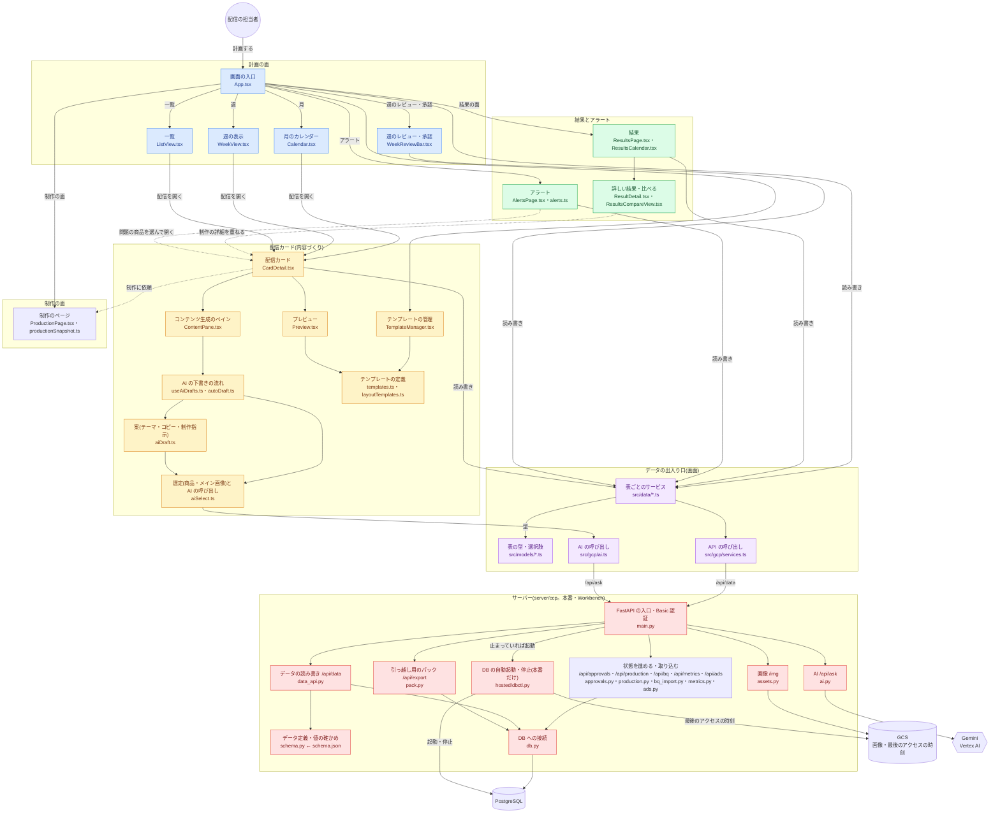

# ソースの地図: ファイルの構造と役割

CCP のソースファイルが、どこに・何のためにあるかの一覧。はじめてコードを読む人と、「この変更はどこを触ればよいか」を探す人向け。

- 最終更新: 2026-10-20(`main` の時点のファイル。行数は目安)
- 設計の約束事・AI の仕組みの詳しい話は [ARCHITECTURE.md](ARCHITECTURE.md)<!-- hosted:begin -->、サーバー・DB・AI は [GCP.md](GCP.md)、いまどこにいるかは [HANDOVER.md](HANDOVER.md)<!-- hosted:end -->
- ファイルを足したり、役割を変えたりしたら、この表も直す

---

## 1. 全体の形

画面のコード(`src/`)は 1 つで、**データと AI の出入り口だけを差し替えて、2 種類のアプリを作る**。

```
                    画面のコード(src/*.tsx, src/*.ts) ── どちらのビルドでも共通
                                   │
            src/data/<表>.ts の …Service を呼ぶ(型は src/models)
                                   │
              ┌────────────────────┴────────────────────┐
              ▼                                         ▼
 本番(サーバー・Workbench)                      撮影・デモ用
 vite.config.ts                                  vite.mock.config.ts
 src/gcp/services.ts → server/ の API            src/mock/db.ts に差し替え(メモリ上のデータ)
 AI は /api/ask(Gemini)                         AI は src/mock/agent.ts
              │
              ▼
     server/(FastAPI)
     PostgreSQL・画像・Gemini
```

- **Power Apps 版は 2026-10-16 に廃止し、ソースも削除した。** 同じ日に、名前(`cr854_…`)と選択肢の数も、読みやすい名前・文字の値に変えた(GCP.md の「データ定義」)。 <!-- hosted -->
- 撮影・デモ用の差し替えは、`vite.mock.config.ts` のプラグインが、サービスの読み込みを置き換えて行う。そのため、画面のコードはビルドの違いを知らない。

### 構成図(ファイルのつながり)

主なファイルと、呼び出しのつながり。GitHub では、図として表示される。 同じ図の draw.io 版は [source-map.drawio](source-map.drawio)(Confluence の draw.io などで読み込める。中の言葉は、動かす環境に依存しない書き方にしてある)。下の図を変えたら、draw.io 版も合わせる。



- 実線は呼び出し、点線は「上に重ねて開く」つながり。
- 撮影・デモ用のビルドでは、「表ごとのサービス」と「AI の呼び出し」が、`src/mock/`(メモリ上のデータ・サンプルの返答)に差し替わる。サーバー側は使わない。

## 2. 一番上の階層

| パス | 役割 |
|---|---|
| `src/` | 画面のコード(React 19 + TypeScript + Fluent UI v9) |
| `server/` | サーバー(Python / FastAPI)。画面・データ API・AI・画像を配る |
| `scripts/` | 反映・検証・撮影・Workbench の運用などの補助スクリプト |
| `docs/` | 文書、ワイヤーフレーム、スクリーンショット、サンプルデータ(CSV) |
| `.github/workflows/ci.yml` | GitHub の CI(スキーマの照合・型チェック・lint・ビルド・サーバーのテスト) | <!-- hosted -->
| `index.html` | 画面の入口の HTML |
| `vite.config.ts` / `vite.mock.config.ts` | ビルドの設定(本番 / 撮影用。1 章) |
| `package.json` | npm のスクリプト(`dev`・`build`・`verify`<!-- hosted:begin -->・`deploy:gcp`<!-- hosted:end -->・`dev:gcp` と `build:gcp`(`dev`・`build` と同じ。Workbench の手順のため)<!-- hosted:begin -->・`screenshots`<!-- hosted:end -->・`seed:export`・`release:workbench`) |
| `Dockerfile` / `.dockerignore` / `.gcloudignore` / `cloudbuild.yaml` | Cloud Run のコンテナと、そのビルド | <!-- hosted -->
| `tsconfig*.json` / `eslint.config.js` | 型チェック・lint の設定 |
| `CLAUDE.md` / `README.md` | AI アシスタント向けの約束事 / 全体の紹介 |

## 3. 画面(`src/`)

### 3.1 入口と土台

| ファイル | 行数 | 役割 |
|---|---|---|
| `main.tsx` | 14 | 起動。フォント・CSS を読み、`Root` を描く |
| `Root.tsx` | 12 | Fluent UI のテーマで `App` を包む |
| `App.tsx` | 2,042 | **画面の入口**。ヘッダー(システム全体: 国・アラート・依頼・新規作成・あなた・⚙)、作業の段(計画 / 制作 / 結果 の切り替えと絞り込み)、面の帯、月 / 週 / 一覧の切り替え、フロート(配信カード・制作のページ・結果・アラート)を開く、画面の状態と URL の行き来 |
| `deepLink.ts` / `CopyLinkButton.tsx` | 89 / 49 | 画面の状態(面・見せ方・期間・国・開いているフロート)を URL のクエリと行き来させる / 「リンクをコピー」 |
| `faces.ts` / `FaceBadge.tsx` / `StageNav.tsx` | 25 / 36 / 114 | 面(計画・制作・結果)の色と名前 / フロートの面の札 / フロートの段階の帯(PLAN → PRODUCTION → RESULTS) |
| `floatLayout.ts` | 67 | フロートの大きさとペインの幅を変えて覚える、共通の部品 |
| `MePicker.tsx` / `InboxButton.tsx` | 218 / 62 | 右上の「あなた」(選んでログイン・切り替え・ログアウト。最初の「だれでログインしますか?」) / 右上の「依頼」(自分宛ての承認の依頼) |
| `theme.ts` | 70 | Fluent UI のテーマ(色・書体) |
| `fonts.ts` | 23 | 同梱のフォント(外部の CDN に頼らない) |
| `index.css` | — | 全体の CSS と、印刷(週の資料・レポート)のときの見せ方 |
| `i18n.ts` | 145 | 日本語 / English の切り替え(`t` / `tr` / `useT` / `optionLabel`) |
| `appRoot.ts` | 22 | アプリの置き場所。API・画像のパスの基準(Workbench の `/proxy/8082/` の下でも動くように) |
| `settings.ts` | 36 | アプリ全体の設定(自動下書きのオン・オフなど。ブラウザごと) |

### 3.2 計画の面(カレンダー・週・一覧)

| ファイル | 行数 | 役割 |
|---|---|---|
| `Calendar.tsx` | 302 | 月のカレンダー(配信・締め切りの近い配信・アラートの印) |
| `WeekView.tsx` | 454 | 週の表示(縮小プレビューつき。商品のバランス / 進み具合 / 時刻 の 3 つの見方。時刻は `WeekTimeGrid`) |
| `WeekTimeGrid.tsx` | 314 | 週の表示の「時刻」の見方(X46。横 = 曜日・縦 = 時刻の格子に配信を置く。同じ時刻の印、つかんで別の日・時刻へ動かす(15 分きざみ)) |
| `WeekReviewBar.tsx` | 226 | 週の状態の帯(レビューに出す・確定・承認、確定後の変更、承認の履歴、PDF) |
| `WeekChecklist.tsx` | 180 | 週の確認の一覧(項目ごとの件数と中身) |
| `reviewChecks.ts` | 196 | 週の確認の判定(上限超えの商品・主力の漏れ・連続 など) |
| `weekLabels.ts` | 66 | 週のレビューの項目名・説明・履歴の文言(画面と PDF で共通) |
| `weekLock.ts` | 29 | 確定した週の、変更の制限 |
| `LockMark.tsx` | 19 | 週が確定した配信の鍵マーク(配信は「承認済み」に添えて見分ける。U6) |
| `WeekReport.tsx` / `printWeek.ts` | 203 / 48 | 週の資料(A4 の PDF)と、その印刷 |
| `ListView.tsx` / `listRows.ts` | 100 / 110 | 表の形の一覧と、その列の定義(CSV の書き出しも同じ定義) |
| `MiniCalendar.tsx` | 166 | ツールバーのミニカレンダー(月・週・日へ移る) |
| `useWeekFrames.ts` / `bulkDraft.ts` | 298 / 293 | 週の枠とまとめて AI で中身を作る(W14)の、画面の状態と操作(App が持つ) / 枠を作る・中身を作る・書き込む部分(React を使わない) |
| `FrameBar.tsx` / `FrameCard.tsx` / `CheckDrawer.tsx` | 150 / 136 / 230 | 週の枠の帯(国・チャネル、配信名の案、中身を作る) / 週の列の枠(配信名・種類) / 未確認の AI 下書きを確かめる引き出し(中身・比べる・確認した)。中身・比べるの表示は `CheckView` として作業画面でも使う |
| `useBulkWorkspace.ts` / `BulkWorkspace.tsx` | 585 / 891 | まとめて作る作業画面(W14 の 4 回目の見直し)の状態と操作(App が持つ。① は保存しない) / 画面(① 対象と方向 → ② 中身を AI で作る → ③ 確かめる。① のあと、中身を作らずに保存もできる) |
| `DeliveryPeek.tsx` / `CardPreview.tsx` | 34 / 68 | 配信にマウスを重ねたときのプレビュー / 保存済みの配信カードのプレビュー |
| `status.ts` / `progress.ts` | 53 / 167 | 配信のステータスの色・チャネル / 工程(進み具合) |
| `ChannelBadge.tsx` | 54 | メール / アプリの札(配信カード・月・週・一覧・結果で共通) |
| `StatusFlow.tsx` / `MonthSummaryBar.tsx` | 46 / 65 | 件数の流れ(未起案 › 承認待ち › 承認済み)/ 月の要約の帯 |
| `WeekRetro.tsx` / `WeekHistory.tsx` | 147 / 60 | 週の振り返りのメモ(結果の面で書き、翌週の計画の面に出す)/ 週の承認の履歴 |
| `DataTable.tsx` | 151 | 一覧の表(並べ替え・サムネイル。計画と結果で共通) |

### 3.3 配信カード(全画面のフロート)

配信カードは 5 ペイン: **左** 配信情報 / **中** コンテンツ生成(タブ) / **プレビュー** / 商品情報(参照専用) / **右端** プロセス(状態・承認・引き継ぎ・やり取り・タスク)。

| ファイル | 行数 | 役割 |
|---|---|---|
| `CardDetail.tsx` | 1,817 | **配信カードの本体**。5 ペインの配置、読み込み・保存、AI の下書きの起動、承認・差し戻し |
| `CardMenu.tsx` | 160 | 「…」メニュー(取りやめ・削除 など) |
| `cancel.ts` | 61 | 配信の取りやめ(消さずに残す) |
| `CardAlertsBar.tsx` | 113 | 配信カードの上の、アラートの帯(たたむ・種類の札・「対応する」) |
| `AbResult.tsx` / `abResults.ts` | 174 / 147 | 詳しい結果の「AB テストの結果」(案ごとの数字・勝ち案・偶然の範囲かの目安)/ その計算(2 つの割合の z 検定・学びの文) |
| `abSeed.ts` | 227 | ⚙ の「AB テスト・案から選ぶの例を作る」(例の配信 5 本を足す。`ab_test` の `seed` で見分ける) |
| `ImpactView.tsx` / `impact.ts` / `useDeliveryImpact.ts` | 740 / 329 / 71 | 結果の面の見せ方「効果」(増えた売上・リフト率、学びの記録と評価)/ その計算と見本 / 詳しい結果に出す、配信 1 本の効果 |
| `SwipePager.tsx` | 158 | 週・月の表示を、地の部分をつかんで横に引く(トラックパッドの横スワイプ)と、前後の週・月へ |
| `AbBadge.tsx` / `AbCompare.tsx` / `abAi.ts` | 47 / 99 / 83 | AB テストの印(月・週・一覧・時刻の格子)/ 案のプレビューを並べて比べる / 「B 案を AI で作る」 |
| `abTest.ts` / `AbTestBar.tsx` | 114 / 173 | AB テスト(X55)の型・既定・配分・制作に渡す文 / 配信カードの題名の下の、案の切り替えとテストの設定の帯 |
| `ProductActionFloat.tsx` / `ItemAlertOverlay.tsx` | 315 / 130 | 商品の対応のフロート(アラートへの対応と、商品の詳しい情報・差し替えを 1 つに。つかんで動かせる)/ プレビューの商品の枠に重ねるアラートの札 |
| `ProductFloat.tsx` / `ProductMarks.tsx` | 35 / 63 | 商品の行の開き口(中の「選定済み」・右の商品情報の行を押すと、商品の対応のフロートを開く。行の中のボタン・入力欄は除く)/ 商品の行の札(アラートの種類の札・「残少」。商品情報と中の選定済みの行で共通) |
| `target.ts` | 45 | 配信の対象(性別・年代・アプリの送る相手)の値と表示、AI に渡す文、商品の性別での絞り込み |
| `ProcessPane.tsx` / `ApprovalBar.tsx` | 289 / 327 | 右端のプロセスのペイン(状態・承認・引き継ぎ・制作の依頼の札)/ 承認の依頼・承認・差し戻し |
| `LearningsBar.tsx` | 162 | 「これまでの学び」(過去の結果から) |
| `Splitter.tsx` / `ResizeHandles.tsx` | 49 / 67 | ペインの幅の変更 / フロートの大きさの変更 |

**中ペイン(コンテンツ生成)** — 選んだ商品の操作は、ここだけで行う

| ファイル | 行数 | 役割 |
|---|---|---|
| `ContentPane.tsx` | 1,397 | **中ペインの本体**。テーマ・テンプレート・メイン画像・セクション・制作指示のタブと、リンク先・引き継ぎ |
| `useSelection.ts` | 156 | 選定した商品・候補の操作(昇格・降格・並べ替え・ドラッグ&ドロップ) |
| `ProductRow.tsx` / `Candidates.tsx` | 139 / 145 | 選定した商品の行 / 候補の一覧(大量でも重くならないように) |
| `HeroCandidates.tsx` | 124 | メイン画像の候補(すべての画像から探して設定) |
| `ChatPanel.tsx` | 280 | AI チャット |
| `NotesEditor.tsx` / `MarkdownLite.tsx` | 124 / 51 | 制作指示の入力(Markdown)/ その表示 |
| `LinksEditor.tsx` / `links.ts` | 146 / 230 | リンク先の入力 / 配信ごとのリンク先(JSON で保存) |
| `HandoffPanel.tsx` | 89 | 制作への引き継ぎ |
| `pushLink.ts` / `AppLinksEditor.tsx` | 46 / 218 | 通知を押したときに開く画面 / アプリのリンク先の入力 |
| `TasksPanel.tsx` | 186 | タスク(プロセスのペインの「タスク」タブ) |
| `CommentsPanel.tsx` | 581 | プロセスのペインの「やり取り」(以前の質問とレビューのコメントを 1 つに。宛先・対象・返信・解決・AI でタスクの案) |
| `AiButton.tsx` / `AiMark.tsx` | 14 / 17 | AI に頼むボタン / AI の印 |
| `AutoTextarea.tsx` | 23 | 内容に合わせて高さが伸びる、複数行の入力 |

**プレビュー**

| ファイル | 行数 | 役割 |
|---|---|---|
| `Preview.tsx` | 951 | **メール・プッシュのプレビュー**(受信側の見た目。色の直書きは、ここだけ例外) |
| `FitPreview.tsx` | 30 | プレビューを、スクロールせずに全体が見える大きさに縮める |
| `LinkOverlay.tsx` | 188 | プレビューの上に、リンク先の番号・枠・URL の吹き出しを重ねる |

**右ペイン(商品情報。参照専用で、操作する部品を置かない)**

| ファイル | 行数 | 役割 |
|---|---|---|
| `ProductInfoPane.tsx` | 154 | 載せた商品の情報の一覧 |
| `ProductDetail.tsx` / `MiniChart.tsx` | 179 / 86 | 商品の詳しい情報(商品の対応のフロートの右。タブ: 売上・在庫 / 基本情報 / 指標 / 販売方針・販促)/ 推移のグラフ |
| `ProductMetrics.tsx` / `useProductMetrics.ts` / `metrics.ts` | 121 / 66 / 60 | 商品の詳しい情報の「指標」タブ(X48。商品とカテゴリの、いちばん新しい週の値・順位・WoW・MoM・YoY)/ その読み込み / 項目の一覧と値・増減の書き方(画面では計算しない) |
| `useProductData.ts` | 83 | 商品の週ごとの実績などを読む(開いている間だけ覚える) |
| `ImageThumb.tsx` | 44 | 画像のサムネイル |

### 3.4 AI

AI の呼び出しは **`askAgent`(`aiSelect.ts`)だけ**を通す。指示文は日本語で書き、English の画面では `localizePrompt` が言い換える。

| ファイル | 行数 | 役割 |
|---|---|---|
| `aiSelect.ts` | 759 | **AI の呼び出しの入口**(`askAgent`)と、商品・メイン画像・見出し・コピーの選定 |
| `aiDraft.ts` | 284 | テーマ・コピー・制作指示の「案」 |
| `autoDraft.ts` | 197 | 「すべてAIで下書き」(1 回で 6〜9 回呼ぶ) |
| `useAiDrafts.ts` | 248 | 下書きの状態を、画面に渡すフック |
| `aiReview.ts` / `aiCompare.ts` | 43 / 53 | 結果の振り返り / 配信どうしの比較 |
| `aiTasks.ts` | 42 | 制作とのやり取りから、タスクの案を出す |
| `themeTypes.ts` / `themeGuess.ts` | 70 / 22 | テーマの種類 / 言葉から種類を推し量る |

### 3.5 アラート

| ファイル | 行数 | 役割 |
|---|---|---|
| `AlertsPage.tsx` / `AlertsFloat.tsx` | 453 / 43 | アラートの画面(左に一覧、右に選んだアラート)/ それを重ねて開くフロート |
| `alerts.ts` | 342 | **在庫のアラートの計算**(配信日の在庫の見込み)と、変更のアラート |
| `cardAlerts.ts` | 124 | アラートを、配信ごとに分ける(カード・カレンダーの印) |
| `alertSettings.ts` / `AlertSettingsDialog.tsx` | 94 / 113 | アラートの条件(ブラウザごと)と、その設定の画面 |
| `alertActions.ts` / `AlertActionPanel.tsx` | 157 / 221 | アラートへの対応(商品の差し替え・延期) |
| `ChangeAlertDetail.tsx` | 221 | 変更のアラート(方針・日程の変更)の詳しい中身 |
| `AlertMark.tsx` | 19 | カレンダーの配信に付ける、アラートの印 |
| `history.ts` | 71 | 操作の履歴の記録の入り口(承認・ステータスの変更) |

### 3.6 結果の面

| ファイル | 行数 | 役割 |
|---|---|---|
| `ResultsPage.tsx` / `ResultsSummaryBar.tsx` | 513 / 79 | 結果の面(月 / 週 / 一覧、まとめ方、取り込み・書き出し。商品別は `ProductsView`、比べるは `ResultsCompareView`)/ 結果の面の月の要約の帯(通貨ごとの売上・前月比・前年比・開封率・クリック率) |
| `ResultsCalendar.tsx` | 187 | 結果の月・週の表示 |
| `ResultsCompareView.tsx` | 371 | 条件で絞り込んだ配信を並べて比べる |
| `ProductsView.tsx` | 385 | 見せ方「商品別」(X49。期間の中で、商品(SPU / カテゴリ)ごとに、載せた配信と回数・結果・週ごとの実績・外部広告の出稿を並べる) |
| `ResultDetail.tsx` | 203 | 詳しい結果のフロート(段階の帯、載せた商品の販売チャネルごとの順位を含む) |
| `ProductRankings.tsx` / `rankingSettings.ts` | 193 / 39 | 詳しい結果の「販売チャネルごとの順位」(R17。全社 / EC / 配信経由。配信前 4 週で Top N に入った週の数と、配信の週・翌週の順位)/ 「上位」とみなす線 Top N(既定 60。ブラウザごと) |
| `ResultSummary.tsx` | 184 | 主な数字と、メモ・商品の売れ方・AI の案 |
| `ResultCompare.tsx` | 324 | 過去の配信と比べる・AI の振り返り |
| `ResultPeek.tsx` | 85 | 計画の面で、配信カードの上に結果を重ねる |
| `HeatPreview.tsx` | 193 | プレビューの上に、リンクごとのクリックを重ねる |
| `results.ts` | 256 | 結果の計算(前週比・前年比・まとめ)と、CSV の読み書き |
| `printReport.ts` | 35 | 配信 1 本のレポートの印刷 |
| `csv.ts` | 34 | CSV の読み方(サンプルデータと結果の取り込みで共通) |

### 3.7 テンプレート

| ファイル | 行数 | 役割 |
|---|---|---|
| `templates.ts` | 554 | **テンプレートの定義**(標準 10 種はコードに持つ)と `getTemplate(id)`。以前からの標準 6 種は、セクションの構成を変えない |
| `layoutTemplates.ts` | 225 | ユーザーが作ったテンプレート(DB)の読み書き、上限 |
| `TemplateManager.tsx` | 704 | テンプレートの管理画面 |
| `TemplateThumb.tsx` / `PushThumb.tsx` | 241 / 55 | テンプレートの見取り図(メール / アプリの通知) |

### 3.8 共通の小さな部品・値

| ファイル | 行数 | 役割 |
|---|---|---|
| `items.ts` | 38 | 配信に載せる商品 1 件の型 |
| `market.ts` | 10 | 商品・メイン画像の市場(JP / US)と、配信カードの国の対応 |
| `labels.ts` | 29 | 選択肢の表示名を、値から補う |
| `images.ts` | 26 | 同梱のイラスト(画像の URL が空のとき) |
| `assets/products/` ・ `assets/heroes/` | — | 同梱のイラスト(商品・メイン画像) |

### 3.8.1 承認

| ファイル | 行数 | 役割 |
|---|---|---|
| `approvals.ts` / `weekApprovals.ts` | 51 / 51 | 承認者になれる人の判断 / 週のまとめての依頼・承認 |
| `people.ts` / `useApprovalInbox.ts` | 93 / 82 | ユーザー・承認グループ・承認のルール(すべての配信に同じ 1 つ)の読み込み / 自分宛ての依頼 |
| `PeopleManager.tsx` | 408 | ⚙ の「ユーザーと承認グループ」 |
| `PolicyManager.tsx` / `policyCheck.ts` | 344 / 126 | ⚙ の「方針と決まり」/ AI の案が決まりを守っているかの確かめ |

### 3.8.2 制作

| ファイル | 行数 | 役割 |
|---|---|---|
| `ProductionPage.tsx` | 572 | **制作のページ**(フロート。要素の情報・HTML のエディタ・プレビュー・やり取り、工程の帯) |
| `ProductionInfoPane.tsx` | 344 | 制作のページの左のペイン(要素の情報。コピー・直す・企画の値に戻す) |
| `HtmlEditor.tsx` / `HtmlPreviewFrame.tsx` | 78 / 108 | HTML のエディタ(開いたときに読み込む)/ HTML をそのまま描くプレビュー(縮小・拡大・全体) |
| `productionSnapshot.ts` | 317 | 配信カードの写し(制作に要る中身を固める)、コピー用の行、プレビューの HTML の書き出し |
| `useProductionRequests.ts` / `notesStage.ts` | 65 / 11 | 制作の依頼の読み込み(制作の面・札)/ やり取りの段階(企画 / 制作) |

### 3.9 データの出入り口

| パス | 役割 |
|---|---|
| `models/` | 表の行の型と、選択肢の値(`export const DeliveryCardStatus = { not_started: '未起案', … }`) |
| `data/` | 表ごとの読み書きのサービス(`DeliveryCardsService` など)。一部の表は、型もここに持つ |
| `gcp/services.ts` | サーバーの `/api/data/…` を呼ぶ、データの入出力(`tableService`) |
| `gcp/ai.ts` | AI の依頼のサービス(サーバーの `/api/ask` を呼ぶ) |
| `gcp/bq.ts` | BigQuery からの取り込みの呼び出し(サーバーの `/api/bq`。画面を開いたときと ⚙ の「BigQuery から取り込む」) |
| `gcp/dbWake.ts` | 「データベースを準備中」の表示 |
| `mock/db.ts` ・ `mock/agent.ts` ・ `mock/seed.ts` | 撮影・デモ用の、DB と AI の身代わりと、サンプルデータ(本番のビルドには入らない) |
| `mock/approvals.ts` ・ `mock/production.ts` ・ `mock/me.ts` ・ `mock/metricsImport.ts` ・ `mock/ads.ts` ・ `mock/csv.ts` | 撮影・デモ用の、サーバーの窓口(`/api/approvals`・`/api/production`・`/api/me`・指標の取り込み)の身代わりと、外部広告の出稿の見本(`server/ccp/ads.py` と同じ作り方) |

## 4. サーバー(`server/`)

| パス | 行数 | 役割 |
|---|---|---|
| `ccp/main.py` | 121 | **サーバーの入口**。画面(`dist-gcp/`)・API を 1 つのプロセスで配る。Basic 認証 |
| `ccp/data_api.py` | — | `/api/data/{テーブル}` の読み書き。初めて DB につないだとき、足りない列・テーブルを足す |
| `ccp/schema.py` | 342 | `schema.json` の読み込み、値の変換、選択肢の確かめ、以前の名前・値からの移行 |
| `ccp/legacy_names.json` | — | 以前の名前(`cr854_…`)・値から、いまの名前への対応(`schema.py` の移行が読む) |
| `schema.json` | — | **データ定義**(テーブル・列・選択肢の値)。列を足すときはここ |
| `ccp/db.py` | — | PostgreSQL への接続(`DATABASE_URL`) |
| `ccp/dbready.py` | — | DB が使えるかどうか(DB を必要なときだけ起動する環境のための、差し込み口)。使えないときの `DbNotReady` |
| `ccp/hosted/` | — | 開発元の本番(Cloud Run + Cloud SQL)だけで使うもの。`dbctl.py`(Cloud SQL の自動起動・自動停止)・`connect.py`(Cloud SQL Connector)・`routes.py`(Cloud Scheduler が呼ぶ `/internal/idle-check`)・`devtoken.py`(手元の gcloud のトークン)。Workbench 版のリリースには入れない([RELEASE.md](RELEASE.md)) | <!-- hosted -->
| `ccp/ai.py` | 89 | `/api/ask`。依頼文を Gemini(Vertex AI)に渡し、返答をそのまま返す |
| `ccp/approvals.py` | 359 | 承認の依頼・承認・差し戻し・やり直し(`/api/approvals`) |
| `ccp/production.py` | 300 | 制作の依頼(`/api/production`。依頼・受け取る・終わった・仕上がりの確認(OK / 直してほしい)・送る・やり直す・HTML・要素の直し) |
| `ccp/identity.py` | 96 | ログインしている人(`/api/me`) |
| `ccp/policies.py` | 335 | 方針と決まりの取り込みと、AI への渡し方 |
| `ccp/metrics.py` | 171 | 商品・カテゴリの週の指標の取り込み(`/api/metrics/import` と `ccp.cli import-metrics`。CSV の週 × 市場の行を置き換える) |
| `ccp/ads.py` | 93 | 外部広告の出稿の記録(表 `ad_spends`。X49)。`/api/ads/sample` で見本を作り直す(消すのは `campaign` が `sample:` で始まる行だけ) |
| `ccp/bq.py` / `ccp/bq_import.py` / `ccp/bq_validate.py` | 139 / 346 / 259 | BigQuery の出力の定義 / 取り込み(SPU・SKU・在庫・週ごとの実績・天気予報・販売チャネルごとの順位。商品の性別の読み替え)/ 取り込む前の確かめ |
| `ccp/bq_dummy.py` | 300 | BigQuery の見本のデータ(ダミーの元の表)を作る運用ツール |
| `ccp/ranking_dummy.py` | 82 | 商品の販売順位(`product_rankings`)のダミーを作る運用ツール(`ccp.cli ranking-dummy`。BigQuery から取り込んだ行があれば何もしない) |
| `ccp/assets.py` | — | `/img/…`。商品・メイン画像を、GCS か `ASSET_DIR` のフォルダから配る |
| `ccp/creds.py` | — | Google の認証(サービスアカウント) |
| `ccp/pack.py` | 113 | 引っ越し用のパック(すべてのデータと画像の ZIP)の書き出し・取り込み |
| `ccp/cli.py` | — | 運用のコマンド(`migrate` / `seed` / `counts` / `check` / `import-pack` / `import-metrics` / `bq-check` / `bq-dummy` / `ranking-dummy`) |
| `ccp/check.py` | 172 | 動かす前の確認(設定・DB・写真・画面のビルド) |
| `ccp/importer.py` | — | 画像から、デモ用の商品・メイン画像のデータを作って取り込む運用ツール |
| `seed.json` | — | 初期データ(`scripts/export-seed.mjs` が `src/mock/seed.ts` から作る) |
| `ccp/impact.py` | — | 配信の効果の見本(⚙ の「効果の見本を作る」。`POST /api/impact/sample`。見本の行だけを置き換える) |
| `tests/` | — | サーバーのテスト(`python -m unittest discover server/tests`。CI でも実行) |
| `requirements.txt` / `requirements-tools.txt` | — | Python のパッケージ(サーバー / 運用ツール) |
| `requirements-hosted.txt` | — | 開発元の本番だけのパッケージ(Cloud SQL Connector) | <!-- hosted -->
| `workbench.env.example` | — | Workbench の設定の見本(本物の `workbench.env` は Git に入れない) |

## 5. スクリプト(`scripts/`)

| ファイル | 役割 |
|---|---|
| `workbench.sh` | Workbench の操作(`setup` / `update` / `start` / `stop` / `status` / `check` / `import` / `log`) |
| `deploy-gcp.mjs` | 本番(Cloud Run)への反映(`npm run deploy:gcp`。main・最新・変更なしのときだけ) | <!-- hosted -->
| `release-workbench.mjs` | 利用先に渡す Workbench 版の ZIP を作り、検査する(`npm run release:workbench`。[RELEASE.md](RELEASE.md)) | <!-- hosted -->
| `check-schema.mjs` | `server/schema.json` と画面の型(`src/models`・`src/data`)の食い違いの検出(`npm run verify`) |
| `check-approvals.mjs` | 承認の判定(`src/approvals.ts`)が、サーバーと同じ例(`server/tests/approval_cases.json`)で同じ結果になるかの確かめ(`npm run verify`) |
| `check-policy.mjs` | must の決まりの確かめ(`src/policyCheck.ts`)が、例どおりに動くかの確かめ(`npm run verify`) |
| `export-seed.mjs` | 初期データを `server/seed.json` に書き出す(`npm run seed:export`) |
| `gcp-smoke.mjs` | 本番・手元のサーバーの動作確認(画面を開いて、カードが出るか) | <!-- hosted -->
| `screenshots.mjs` | スクリーンショットの撮影(撮影用のビルド + 模擬の AI) | <!-- hosted -->
| `feature-reasons.py` | 機能の理由の台帳(`docs/FEATURE_REASONS.md`)を作る |
| `flows-sheet.py` | [FLOWS.md](FLOWS.md) から、照らし合わせの記入用シート([FLOWS_SHEET.md](FLOWS_SHEET.md))を作る(FLOWS.md の表を変えたら流し直す) |

## 6. この変更は、どこを触るか

| やりたいこと | 主に触るところ |
|---|---|
| データの列・テーブルを足す | `server/schema.json`(サーバーが起動後に自動で足す)。型は `src/models/`、新しいテーブルは `src/data/` にサービスを足す |
| AI の指示文・選定のしかたを変える | `src/aiSelect.ts`(選定)・`src/aiDraft.ts`(案)・`src/autoDraft.ts`(すべて下書き)。呼び出しは `askAgent` だけを通す |
| AI のモデル・考える量を変える | 環境変数 `GEMINI_MODEL` / `GEMINI_THINKING`(`server/ccp/ai.py`) |
| 配信カードの中ペインにタブ・機能を足す | `src/ContentPane.tsx`(保存は `src/CardDetail.tsx`) |
| プレビューの見た目を変える | `src/Preview.tsx`(テンプレートの定義は `src/templates.ts`) |
| 在庫のアラートの計算を変える | `src/alerts.ts`(条件は `src/alertSettings.ts`) |
| AB テスト(案の持ち方・設定)を変える | `src/abTest.ts`・`src/AbTestBar.tsx`、案の出し入れと保存は `src/CardDetail.tsx`(`itemsOf`・`switchVariant`・`syncItems`) |
| 商品の対応のフロート(差し替え・詳しい情報)を変える | `src/ProductActionFloat.tsx`(中身は `src/ProductDetail.tsx`、開き口は `src/ProductFloat.tsx`) |
| 商品・カテゴリの指標の項目を足す | `src/metrics.ts`・`server/ccp/metrics.py` |
| 週の確認の項目を足す | `src/reviewChecks.ts` と `src/weekLabels.ts` |
| ヘッダー・ツールバー・面の切り替え | `src/App.tsx` |
| 画面の文言を日英で足す | その場で `t('日本語', 'English')`(`src/i18n.ts`) |
| Workbench の運用を変える | `scripts/workbench.sh`・`server/ccp/check.py`・[WORKBENCH.md](WORKBENCH.md) |
